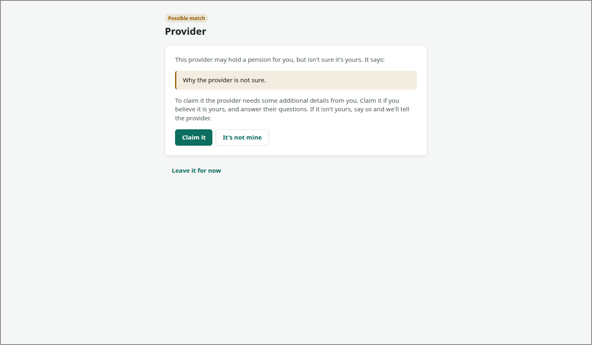

# CLAIM

<!-- ui-walkthrough: view begin. Generated from VIEW.yaml and VIEW.html; edit those, not this block. -->
The saver claims a pension a provider may hold for them: why the provider is not sure, giving it what it asks for to be sure, and its answer, which can take days. What they give goes to that provider only.

**Slots**

| Slot | Holds | How many | Description |
|---|---|---|---|
| `POT` | [POT-ROW](../POT-ROW/VIEW.md) | none or one | The pension, once the provider has confirmed it and it is one of the saver's pots. |

**Components**

| Component | Bindings | Description |
|---|---|---|
| `PROVIDER` | text: `provider` | The provider that may hold the pension. |
| `REVIEW` | visible: `stage == review` | What the provider has said: that it may hold a pension for the saver, and why it is not sure. |
| `REASON` | text: `reason` | Why the provider is not sure. |
| `CLAIM` | visible: `stage == review` | Claims the pension: goes on to what the provider needs to be sure. |
| `NOT-MINE` | visible: `stage == review` | Says the pension is not the saver's: the possible match is dropped, and the provider told. |
| `ASK` | visible: `stage == ask` | What the provider needs to be sure. The provider decides what that is. |
| `EMPLOYER` | text: `employer` | The employer the saver worked for while a member. |
| `WHEN` | text: `when` | When they worked there. |
| `ADDRESS` | text: `address` | The address they lived at then. |
| `MEMBERSHIP` | text: `membership` | Their membership number, if they have one. |
| `PRIVATE` | visible: `stage in [ask, further]` | Says what the saver gives goes to the provider only, and Pot Tracker does not keep it. |
| `SEND` | visible: `stage == ask` | Sends what the saver gave to the provider. |
| `CHECKING` | visible: `stage == checking` | Says the provider is checking, and when it says it will answer. |
| `ANSWER-BY` | text: `answer-by` | When the provider says it will answer. |
| `LATE` | visible: `stage == late` | Says the provider has not answered by when it said it would. |
| `LATE-BY` | text: `answer-by` | When the provider said it would answer. |
| `REMIND` | visible: `stage == late` | Reminds the provider to answer. |
| `FURTHER` | visible: `stage == further` | The provider's further question, for the saver to answer. |
| `QUESTION` | text: `question` | The provider's question. |
| `ANSWER` | pick: `answer`; options: `answer-options`; open: `picking`; unset: `Choose a month` | The saver's answer, chosen from those the provider offers. |
| `SEND-ANSWER` | visible: `stage == further` | Sends the answer to the provider. |
| `NOT-MATCHED` | visible: `stage == not-matched` | Says the provider could not match the pension to the saver, and why if it says. |
| `WHY` | text: `why` | Why, in the provider's words. |
| `TRY-AGAIN` | visible: `stage == not-matched` | Goes back to giving the provider what it asks for, to try different details. |
| `CONFIRMED` | visible: `stage == confirmed` | Says the provider has confirmed the pension is the saver's, and shows it as one of their pots. |
| `DROPPED` | visible: `stage == dropped` | Says the possible match has been dropped and the provider told. |
| `LEAVE` | visible: `stage in [review, ask, not-matched, late]` | Leaves it for now: the possible match waits for the saver. |
| `BACK` | visible: `stage in [checking, confirmed, dropped]` | Goes back to the overview of every pot. |
<!-- ui-walkthrough: view end -->

<!-- ui-walkthrough: begin. Generated from VIEW.html and VIEW.yaml; edit those, not this block. -->
**Used by**

* Claim a possible match: 01 Choose a possible match ([desk](../../walkthroughs/claim-a-possible-match/01-choose/STEP.desk.md) · [phone](../../walkthroughs/claim-a-possible-match/01-choose/STEP.phone.md))
* Claim a possible match: 01a Say it is not theirs ([desk](../../walkthroughs/claim-a-possible-match/01a-not-mine/STEP.desk.md) · [phone](../../walkthroughs/claim-a-possible-match/01a-not-mine/STEP.phone.md))
* Claim a possible match: 02 Be asked what the provider needs ([desk](../../walkthroughs/claim-a-possible-match/02-claim/STEP.desk.md) · [phone](../../walkthroughs/claim-a-possible-match/02-claim/STEP.phone.md))
* Claim a possible match: 02a Leave it for now ([desk](../../walkthroughs/claim-a-possible-match/02a-leave/STEP.desk.md) · [phone](../../walkthroughs/claim-a-possible-match/02a-leave/STEP.phone.md))
* Claim a possible match: 03 Give what they know ([desk](../../walkthroughs/claim-a-possible-match/03-give/STEP.desk.md) · [phone](../../walkthroughs/claim-a-possible-match/03-give/STEP.phone.md))
* Claim a possible match: 04 Be told the provider is checking ([desk](../../walkthroughs/claim-a-possible-match/04-checking/STEP.desk.md) · [phone](../../walkthroughs/claim-a-possible-match/04-checking/STEP.phone.md))
* Claim a possible match: 05 See it confirmed as theirs ([desk](../../walkthroughs/claim-a-possible-match/05-confirmed/STEP.desk.md) · [phone](../../walkthroughs/claim-a-possible-match/05-confirmed/STEP.phone.md))
* Claim a possible match: 05a Answer a further question ([desk](../../walkthroughs/claim-a-possible-match/05a-further-question/STEP.desk.md) · [phone](../../walkthroughs/claim-a-possible-match/05a-further-question/STEP.phone.md))
* Claim a possible match: 05b Be told it could not be matched ([desk](../../walkthroughs/claim-a-possible-match/05b-not-matched/STEP.desk.md) · [phone](../../walkthroughs/claim-a-possible-match/05b-not-matched/STEP.phone.md))
* Claim a possible match: 05c Be told the provider is late ([desk](../../walkthroughs/claim-a-possible-match/05c-late/STEP.desk.md) · [phone](../../walkthroughs/claim-a-possible-match/05c-late/STEP.phone.md))
<!-- ui-walkthrough: end -->
