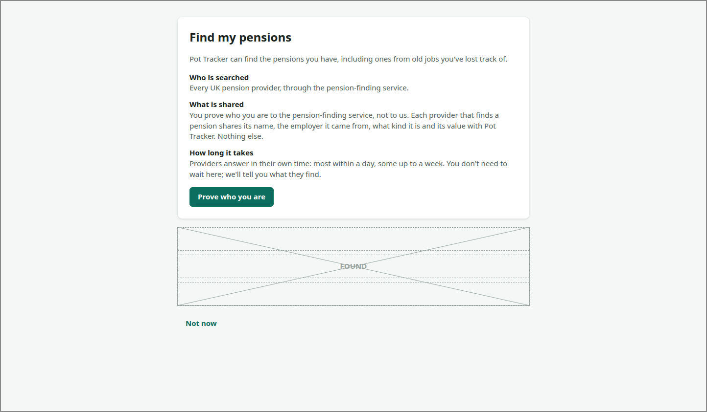

# FIND-PENSIONS

<!-- ui-walkthrough: view begin. Generated from VIEW.yaml and VIEW.html; edit those, not this block. -->
Finding the saver's pensions through the pension-finding service: what will happen, proving who they are to the service, agreeing, and then the search as providers answer, over days. Each pension found is listed as it arrives.

**Slots**

| Slot | Holds | How many | Description |
|---|---|---|---|
| `FOUND` | [POT-ROW](../POT-ROW/VIEW.md), [POSSIBLE-MATCH](../POSSIBLE-MATCH/VIEW.md) | any number | Each pension found, newest first: a pot when its provider is sure, a possible match when it is not. |

**Components**

| Component | Bindings | Description |
|---|---|---|
| `EXPLAIN` | visible: `stage == explain` | Says what will happen: who is searched, what is shared and with whom, and that answers take days. |
| `PROVE` | visible: `stage == explain` | Goes to the pension-finding service, in a window of its own, to prove who the saver is. |
| `AGAIN` | visible: `stage == again` | For a saver whose consent has not ended: says when they agreed and until when, so they need not prove who they are or agree again. |
| `CONSENT-FROM` | text: `consent-from` | When the saver agreed. |
| `SEARCH-AGAIN` | visible: `stage == again` | Starts the search again under the consent already given. |
| `PROVING` | visible: `stage == proving` | Says the saver is proving who they are in the service's window, and that Pot Tracker carries on when they have. |
| `NOT-PROVED` | visible: `stage == not-proved` | Says the search cannot start because the service could not confirm who the saver is, why that can happen, and how to try again. |
| `TRY-AGAIN` | visible: `stage == not-proved` | Goes back to the service to prove who the saver is again. |
| `CONSENT` | visible: `stage == consent` | Asks for the two agreements, separately, and says how long they last. |
| `AGREE-SEARCH` |  | The saver agrees the service may search every UK pension provider for their pensions. |
| `AGREE-SHARE` |  | The saver agrees Pot Tracker may receive what the providers share. |
| `CONSENT-UNTIL` | text: `consent-until` | When the consent already given ends. |
| `ENDS` | text: `consent-until` | When the consent being asked for would end, a year from now. |
| `AGREE` | visible: `stage == consent`; enabled: `agreed-search and agreed-share` | Starts the search; only once the saver has agreed to both. |
| `DECLINE` | visible: `stage == consent` | Declines: no search is made and nothing is shared. |
| `DECLINED` | visible: `stage == declined` | Says no search was made and nothing was shared. |
| `SEARCH` | visible: `stage in [searching, finished]` | The search: when it started, how many pensions have been found, and that answers keep arriving. |
| `STARTED` | text: `started` | When the search started. |
| `FOUND-COUNT` | text: `found` | How many pensions have been found so far. |
| `ARRIVING` | visible: `stage == searching` | Says answers arrive over days, that the saver can leave, and that they will be told what is found. |
| `FINISHED` | visible: `stage == finished` | Says the search has finished. |
| `NONE` | visible: `stage == finished and found-count == 0` | Says no pension was found, and offers adding an investment portfolio instead. |
| `ADD-PORTFOLIO` |  | Starts adding an investment portfolio, when no pension was found. |
| `CANCEL` | visible: `stage in [explain, proving, not-proved]` | Leaves without searching, back to the overview. |
| `BACK` | visible: `stage in [declined, searching, finished]` | Goes back to the overview of every pot. |
<!-- ui-walkthrough: view end -->

<!-- ui-walkthrough: begin. Generated from VIEW.html and VIEW.yaml; edit those, not this block. -->
**Used by**

* Find my pensions: 01 Ask to find their pensions ([desk](../../walkthroughs/find-my-pensions/01-ask/STEP.desk.md) · [phone](../../walkthroughs/find-my-pensions/01-ask/STEP.phone.md))
* Find my pensions: 01a Search again within the year ([desk](../../walkthroughs/find-my-pensions/01a-searched-before/STEP.desk.md) · [phone](../../walkthroughs/find-my-pensions/01a-searched-before/STEP.phone.md))
* Find my pensions: 02 Prove who they are ([desk](../../walkthroughs/find-my-pensions/02-prove/STEP.desk.md) · [phone](../../walkthroughs/find-my-pensions/02-prove/STEP.phone.md))
* Find my pensions: 02a Cannot prove who they are ([desk](../../walkthroughs/find-my-pensions/02a-not-proved/STEP.desk.md) · [phone](../../walkthroughs/find-my-pensions/02a-not-proved/STEP.phone.md))
* Find my pensions: 03 Agree to the search ([desk](../../walkthroughs/find-my-pensions/03-agree/STEP.desk.md) · [phone](../../walkthroughs/find-my-pensions/03-agree/STEP.phone.md))
* Find my pensions: 03a Decline the search ([desk](../../walkthroughs/find-my-pensions/03a-declined/STEP.desk.md) · [phone](../../walkthroughs/find-my-pensions/03a-declined/STEP.phone.md))
* Find my pensions: 04 See the search start ([desk](../../walkthroughs/find-my-pensions/04-started/STEP.desk.md) · [phone](../../walkthroughs/find-my-pensions/04-started/STEP.phone.md))
* Find my pensions: 05 See pensions arrive ([desk](../../walkthroughs/find-my-pensions/05-pensions-arrive/STEP.desk.md) · [phone](../../walkthroughs/find-my-pensions/05-pensions-arrive/STEP.phone.md))
* Find my pensions: 05a Receive a possible match ([desk](../../walkthroughs/find-my-pensions/05a-possible-match/STEP.desk.md) · [phone](../../walkthroughs/find-my-pensions/05a-possible-match/STEP.phone.md))
* Find my pensions: 05b Receive a pension with no value yet ([desk](../../walkthroughs/find-my-pensions/05b-no-value-yet/STEP.desk.md) · [phone](../../walkthroughs/find-my-pensions/05b-no-value-yet/STEP.phone.md))
* Find my pensions: 05c Find a pension already added ([desk](../../walkthroughs/find-my-pensions/05c-already-added/STEP.desk.md) · [phone](../../walkthroughs/find-my-pensions/05c-already-added/STEP.phone.md))
* Find my pensions: 06 Be told the search has finished ([desk](../../walkthroughs/find-my-pensions/06-finished/STEP.desk.md) · [phone](../../walkthroughs/find-my-pensions/06-finished/STEP.phone.md))
* Find my pensions: 06a Find no pensions ([desk](../../walkthroughs/find-my-pensions/06a-none-found/STEP.desk.md) · [phone](../../walkthroughs/find-my-pensions/06a-none-found/STEP.phone.md))
<!-- ui-walkthrough: end -->
