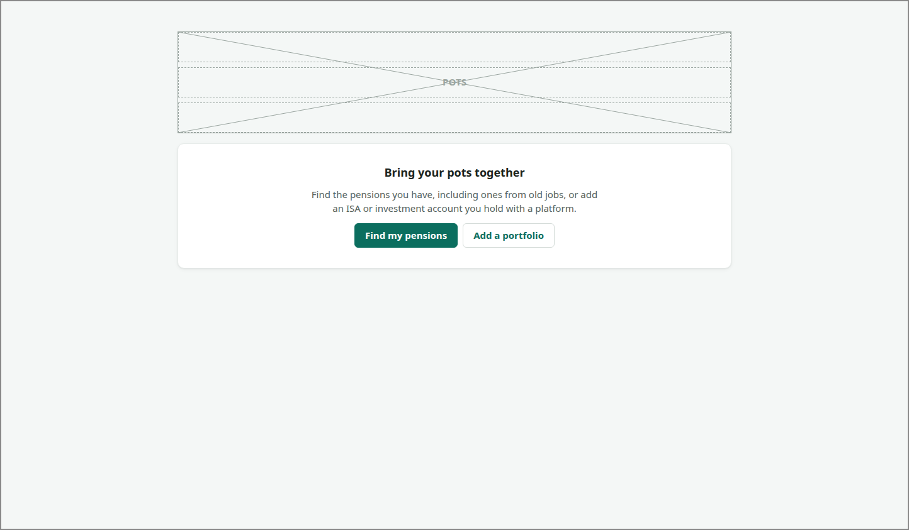

# OVERVIEW

<!-- ui-walkthrough: view begin. Generated from VIEW.yaml and VIEW.html; edit those, not this block. -->
Every one of the saver's pots, each with its value and when that was, and what they add up to. With no pots yet, the two ways to start.

**Slots**

| Slot | Holds | How many | Description |
|---|---|---|---|
| `POTS` | [POT-ROW](../POT-ROW/VIEW.md) | any number | A row for each pot. |

**Components**

| Component | Bindings | Description |
|---|---|---|
| `SUMMARY` | visible: `pot-count > 0` | What every pot adds up to, and when, once there are pots. |
| `TOTAL` | text: `total` | What every pot adds up to. |
| `AS-OF` | text: `as-of` | When the total is as of. |
| `STALE` | visible: `stale-count > 0` | Says some pots' values could not be brought up to date, and are shown as last known. |
| `FIND-PENSIONS` | visible: `pot-count > 0` | Starts finding the saver's pensions, or more of them. |
| `ADD-PORTFOLIO` | visible: `pot-count > 0` | Starts adding an investment portfolio. |
| `START` | visible: `pot-count == 0` | With no pots yet, explains the two ways to start: finding pensions and adding a portfolio. |
| `START-FIND` |  | Starts finding the saver's pensions, from the explanation shown with no pots. |
| `START-ADD` |  | Starts adding an investment portfolio, from the explanation shown with no pots. |
| `SEARCHING` | visible: `search != ""` | Says a pension search is running and how many it has found so far, and goes to it. |
| `SEARCH-FOUND` | text: `search` | How many pensions the running search has found so far. |
| `SEE-SEARCH` |  | Goes to the running pension search. |
| `SINCE` | visible: `found-since != ""` | On signing in, says how many pensions the search found since the saver was last there. |
| `FOUND-SINCE` | text: `found-since` | How many pensions the search found since the saver was last there. |
<!-- ui-walkthrough: view end -->

<!-- ui-walkthrough: begin. Generated from VIEW.html and VIEW.yaml; edit those, not this block. -->
**Used by**

* Find my pensions: 01 Ask to find their pensions ([desk](../../walkthroughs/find-my-pensions/01-ask/STEP.desk.md) · [phone](../../walkthroughs/find-my-pensions/01-ask/STEP.phone.md))
* Find my pensions: 06 Be told the search has finished ([desk](../../walkthroughs/find-my-pensions/06-finished/STEP.desk.md) · [phone](../../walkthroughs/find-my-pensions/06-finished/STEP.phone.md))
* Find my pensions: 06b Be told what was found while away ([desk](../../walkthroughs/find-my-pensions/06b-told-on-sign-in/STEP.desk.md) · [phone](../../walkthroughs/find-my-pensions/06b-told-on-sign-in/STEP.phone.md))
* Sign in: 03 See where their pots stand ([desk](../../walkthroughs/sign-in/03-overview/STEP.desk.md) · [phone](../../walkthroughs/sign-in/03-overview/STEP.phone.md))
* Sign in: 03a Start with no pots ([desk](../../walkthroughs/sign-in/03a-no-pots/STEP.desk.md) · [phone](../../walkthroughs/sign-in/03a-no-pots/STEP.phone.md))
* Sign in: 03b See a value that is not up to date ([desk](../../walkthroughs/sign-in/03b-not-up-to-date/STEP.desk.md) · [phone](../../walkthroughs/sign-in/03b-not-up-to-date/STEP.phone.md))
<!-- ui-walkthrough: end -->
