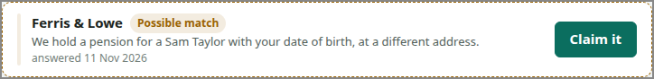

# POSSIBLE-MATCH

<!-- ui-walkthrough: view begin. Generated from VIEW.yaml and VIEW.html; edit those, not this block. -->
A pension a provider may hold for the saver but is not sure is theirs: who the provider is, why it is not sure, and opening it to claim it. It is not a pot until the provider is sure.

**Components**

| Component | Bindings | Description |
|---|---|---|
| `PROVIDER` | text: `match.provider` | The provider that may hold the pension. |
| `REASON` | text: `match.reason` | Why the provider is not sure, in its own words. |
| `RECEIVED` | text: `match.received` | When the provider answered. |
| `CHECKING` | visible: `progress == checking` | Says the provider is checking the saver's claim, and by when it will answer. |
| `ANSWER-BY` | text: `answer-by` | When the provider says it will answer. |
| `LATE` | visible: `progress == late` | Says the provider has not answered by when it said. |
| `SEE-CLAIM` | visible: `progress != waiting` | Goes to the claim. |
| `CLAIM` | visible: `progress == waiting` | Opens the possible match: why the provider is not sure, and claiming it or saying it is not the saver's. |
<!-- ui-walkthrough: view end -->

<!-- ui-walkthrough: begin. Generated from VIEW.html and VIEW.yaml; edit those, not this block. -->
**Used by**

* Claim a possible match: 01 Choose a possible match ([desk](../../walkthroughs/claim-a-possible-match/01-choose/STEP.desk.md) · [phone](../../walkthroughs/claim-a-possible-match/01-choose/STEP.phone.md))
* Claim a possible match: 02a Leave it for now ([desk](../../walkthroughs/claim-a-possible-match/02a-leave/STEP.desk.md) · [phone](../../walkthroughs/claim-a-possible-match/02a-leave/STEP.phone.md))
* Claim a possible match: 04 Be told the provider is checking ([desk](../../walkthroughs/claim-a-possible-match/04-checking/STEP.desk.md) · [phone](../../walkthroughs/claim-a-possible-match/04-checking/STEP.phone.md))
* Claim a possible match: 05c Be told the provider is late ([desk](../../walkthroughs/claim-a-possible-match/05c-late/STEP.desk.md) · [phone](../../walkthroughs/claim-a-possible-match/05c-late/STEP.phone.md))
* Find my pensions: 05a Receive a possible match ([desk](../../walkthroughs/find-my-pensions/05a-possible-match/STEP.desk.md) · [phone](../../walkthroughs/find-my-pensions/05a-possible-match/STEP.phone.md))
<!-- ui-walkthrough: end -->
