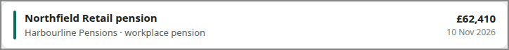

# POT-ROW

<!-- ui-walkthrough: view begin. Generated from VIEW.yaml and VIEW.html; edit those, not this block. -->
One pot in a list: its colour, its name, its provider and kind, and its value with when that was.

**Components**

| Component | Bindings | Description |
|---|---|---|
| `NAME` | text: `pot.name` | The name the saver knows the pot by. |
| `PROVIDER` | text: `pot.provider` | Who holds the pot. |
| `KIND` | text: `pot.kind` | What kind of pot it is, in plain words. |
| `VALUE` | text: `pot.value` | Its value, in pounds. |
| `AS-OF` | text: `pot.as-of` | When the value was brought up to date. |
| `LAST-KNOWN` | visible: `stale` | Says the value is the last known, because it could not be brought up to date. |
<!-- ui-walkthrough: view end -->

<!-- ui-walkthrough: begin. Generated from VIEW.html and VIEW.yaml; edit those, not this block. -->
**Used by**

* Sign in: 03 See where their pots stand ([desk](../../walkthroughs/sign-in/03-overview/STEP.desk.md) · [phone](../../walkthroughs/sign-in/03-overview/STEP.phone.md))
* Sign in: 03d See a value that is not up to date ([desk](../../walkthroughs/sign-in/03d-not-up-to-date/STEP.desk.md) · [phone](../../walkthroughs/sign-in/03d-not-up-to-date/STEP.phone.md))
<!-- ui-walkthrough: end -->
