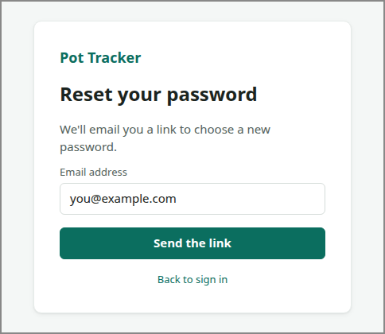

# RESET-PASSWORD

<!-- ui-walkthrough: view begin. Generated from VIEW.yaml and VIEW.html; edit those, not this block. -->
The saver resets a forgotten password: asks for a link, is told it has been sent, and, having followed it, chooses a new password.

**Components**

| Component | Bindings | Description |
|---|---|---|
| `ASK` | visible: `stage == ask` | Asks for the email address to send the link to. |
| `EMAIL` | text: `email` | The email address the saver types. |
| `SEND` | visible: `stage == ask` | Sends the link. |
| `SENT` | visible: `stage == sent` | Says the link has been sent, if the address is a user's, and to follow it from their email. |
| `SENT-TO` | text: `email` | The address the link went to. |
| `CHOOSE` | visible: `stage == choose` | Asks for the new password, twice. |
| `SAVE` | visible: `stage == choose` | Saves the new password, and goes back to signing in. |
| `BACK` | visible: `stage != choose` | Goes back to signing in. |
<!-- ui-walkthrough: view end -->

<!-- ui-walkthrough: begin. Generated from VIEW.html and VIEW.yaml; edit those, not this block. -->
**Used by**

* Sign in: 02c Reset a forgotten password ([desk](../../walkthroughs/sign-in/02c-forgotten-password/STEP.desk.md) · [phone](../../walkthroughs/sign-in/02c-forgotten-password/STEP.phone.md))
<!-- ui-walkthrough: end -->
