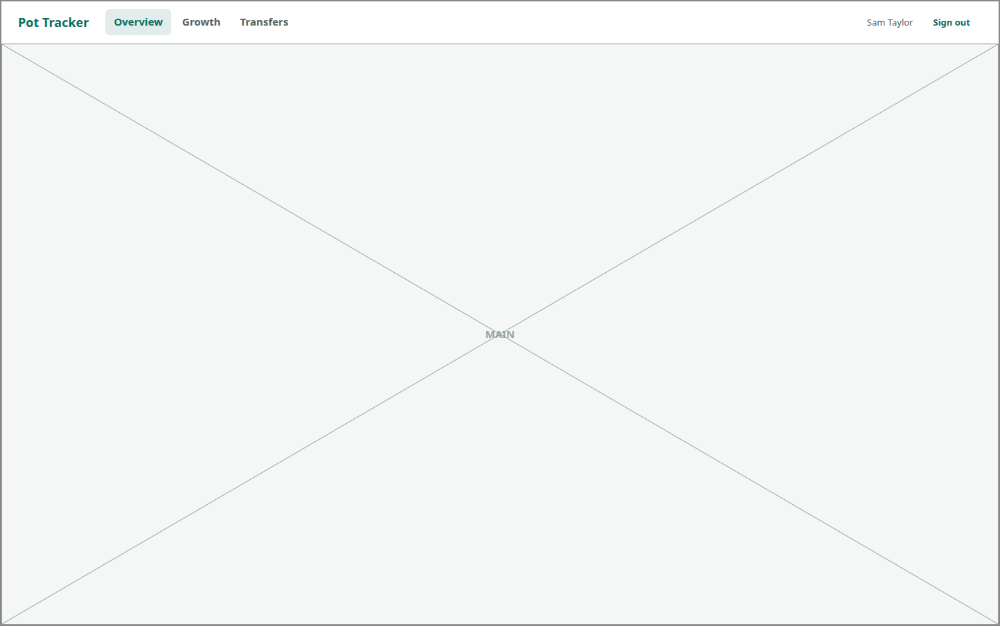

# SHELL

<!-- ui-walkthrough: view begin. Generated from VIEW.yaml and VIEW.html; edit those, not this block. -->
The frame around everything a signed-in saver does: Pot Tracker's name, where they can go, who they are and signing out, and what they are doing in the middle. On a phone, where they can go moves to a bar at the bottom.

**Slots**

| Slot | Holds | How many | Description |
|---|---|---|---|
| `MAIN` | [OVERVIEW](../OVERVIEW/VIEW.md), FIND-PENSIONS *(not defined yet)* | one | What the saver is doing. |

**Components**

| Component | Bindings | Description |
|---|---|---|
| `NAV-OVERVIEW` |  | Goes to the overview of every pot. |
| `NAV-GROWTH` |  | Goes to comparing growth. |
| `NAV-TRANSFERS` |  | Goes to the saver's transfers. |
| `SAVER` | text: `saver` | Who is signed in. |
| `SIGN-OUT` |  | Signs the saver out of this device. |
<!-- ui-walkthrough: view end -->

<!-- ui-walkthrough: begin. Generated from VIEW.html and VIEW.yaml; edit those, not this block. -->
**Used by**

* Sign in: 03 See where their pots stand ([desk](../../walkthroughs/sign-in/03-overview/STEP.desk.md) · [phone](../../walkthroughs/sign-in/03-overview/STEP.phone.md))
* Sign in: 03a Start with no pots ([desk](../../walkthroughs/sign-in/03a-no-pots/STEP.desk.md) · [phone](../../walkthroughs/sign-in/03a-no-pots/STEP.phone.md))
* Sign in: 03b See a value that is not up to date ([desk](../../walkthroughs/sign-in/03b-not-up-to-date/STEP.desk.md) · [phone](../../walkthroughs/sign-in/03b-not-up-to-date/STEP.phone.md))
<!-- ui-walkthrough: end -->
