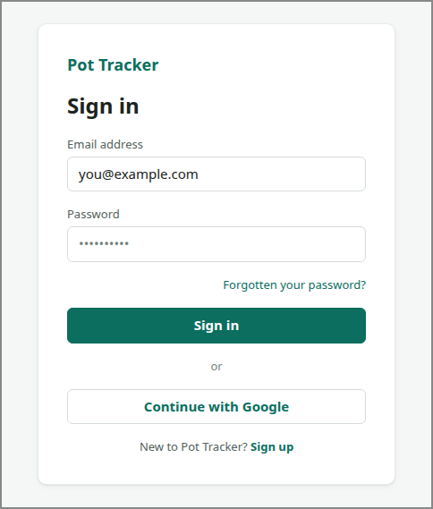

# SIGN-IN

<!-- ui-walkthrough: view begin. Generated from VIEW.yaml and VIEW.html; edit those, not this block. -->
The saver identifies themselves to Pot Tracker, with an email address and password or with Google. Nothing of anyone's pots is shown.

**Components**

| Component | Bindings | Description |
|---|---|---|
| `NOT-IDENTIFIED` | visible: `state == not-identified` | Tells the saver they could not be identified, without saying whether the email address or the password was wrong, and offers signing up. |
| `AWAY` | visible: `state == signed-out-away` | Tells the saver they were signed out because they were away for 15 minutes. |
| `EMAIL` | text: `email` | The email address the saver types. |
| `PASSWORD` |  | The password the saver types. Never held as state, so a step shows it as dots. |
| `SUBMIT` |  | Identifies the saver with the email address and password. |
| `FORGOTTEN` |  | Starts resetting the password, for a saver who has forgotten it. |
| `GOOGLE` |  | Identifies the saver with their Google account instead. |
| `SIGN-UP` |  | Opens signing up, for a saver who is not yet one of Pot Tracker's users. |
<!-- ui-walkthrough: view end -->

<!-- ui-walkthrough: begin. Generated from VIEW.html and VIEW.yaml; edit those, not this block. -->
**Used by**

* Sign in: 01 Go to Pot Tracker ([desk](../../walkthroughs/sign-in/01-go-to-pot-tracker/STEP.desk.md) · [phone](../../walkthroughs/sign-in/01-go-to-pot-tracker/STEP.phone.md))
* Sign in: 02 Identify themselves ([desk](../../walkthroughs/sign-in/02-identify/STEP.desk.md) · [phone](../../walkthroughs/sign-in/02-identify/STEP.phone.md))
* Sign in: 02a Choose Google ([desk](../../walkthroughs/sign-in/02a-google/STEP.desk.md) · [phone](../../walkthroughs/sign-in/02a-google/STEP.phone.md))
* Sign in: 03a Cannot be identified ([desk](../../walkthroughs/sign-in/03a-not-identified/STEP.desk.md) · [phone](../../walkthroughs/sign-in/03a-not-identified/STEP.phone.md))
<!-- ui-walkthrough: end -->
