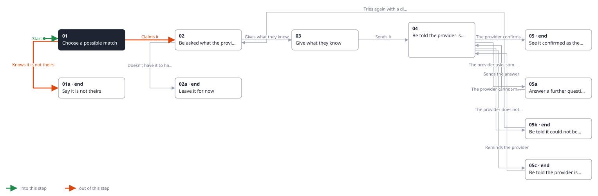
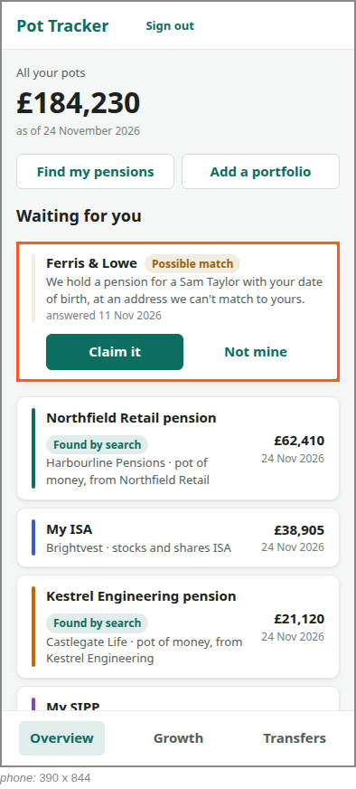
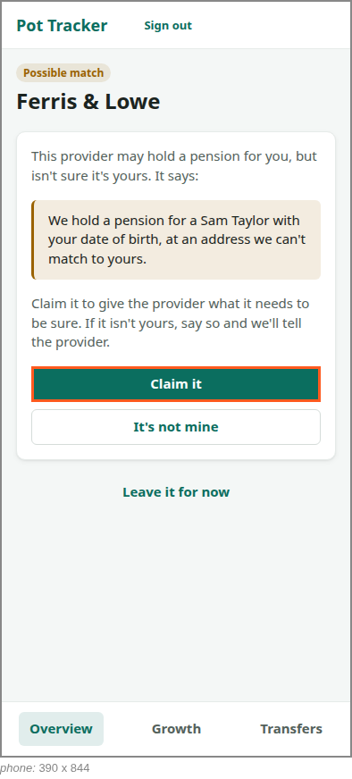

<!-- Generated by ui-walkthrough from WALKTHROUGH.yaml and STEP.yaml. Do not edit. -->
# Claim a possible match

↑ [The whole walkthrough](../WALKTHROUGH.phone.md), which is [Find my pensions: 05a Receive a possible match](../../find-my-pensions/05a-possible-match/STEP.phone.md)

[desk](STEP.desk.md) · **phone**

## 01 Choose a possible match

| Previous | Next |
|:---|---:|
| *Start* | *Claims it* (clicks `CLAIM.CLAIM`): [02 Be asked what the provider needs](../02-claim/STEP.phone.md) → |
|  | *Knows it is not theirs* (clicks `CLAIM.NOT-MINE`): [01a Say it is not theirs](../01a-not-mine/STEP.phone.md) → |

A possible match waits for the saver on the overview, above their pots, as it does in the search that found it.
They choose it, and see what the provider has told them: its name, and why it is not sure the pension is theirs.

### 1. Waiting on the overview, above the saver's pots

**Views**

* [APP](../../../views/APP/VIEW.md)
  * *shows*: [SHELL](../../../views/SHELL/VIEW.md)
    * *main*: [OVERVIEW](../../../views/OVERVIEW/VIEW.md)
      * *pots*: [POT-ROW](../../../views/POT-ROW/VIEW.md) × 4
      * *waiting*: [POSSIBLE-MATCH](../../../views/POSSIBLE-MATCH/VIEW.md)

* **POSSIBLE-MATCH** (highlighted): A pension a provider may hold for the saver but is not sure is theirs: who the provider is, why it is not sure, and claiming it or saying it is not theirs. It is not a pot until the provider is sure.

### 2. Chosen: what the provider said, and why it is not sure

**Views**

* [APP](../../../views/APP/VIEW.md)
  * *shows*: [SHELL](../../../views/SHELL/VIEW.md)
    * *main*: [CLAIM](../../../views/CLAIM/VIEW.md)

* **CLAIM.CLAIM** (highlighted): Claims the pension: goes on to what the provider needs to be sure.
* **CLAIM.REASON**: Why the provider is not sure.
* **CLAIM.NOT-MINE**: Says the pension is not the saver's: the possible match is dropped, and the provider told.
