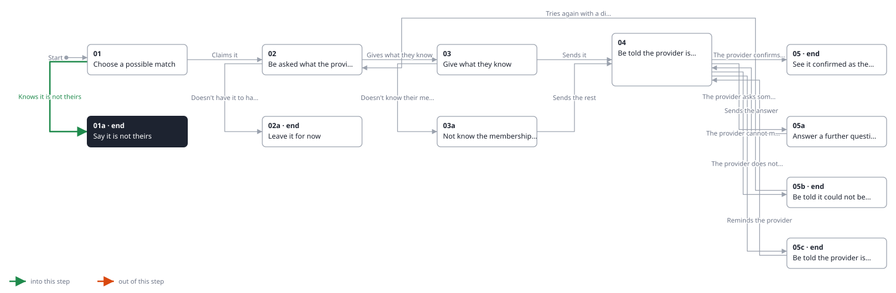
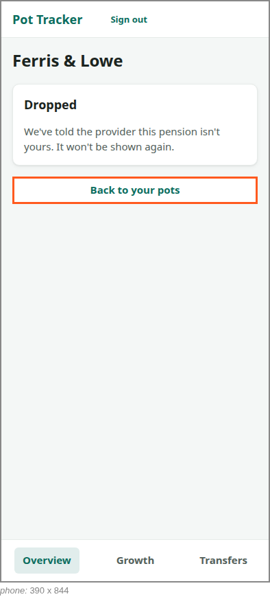
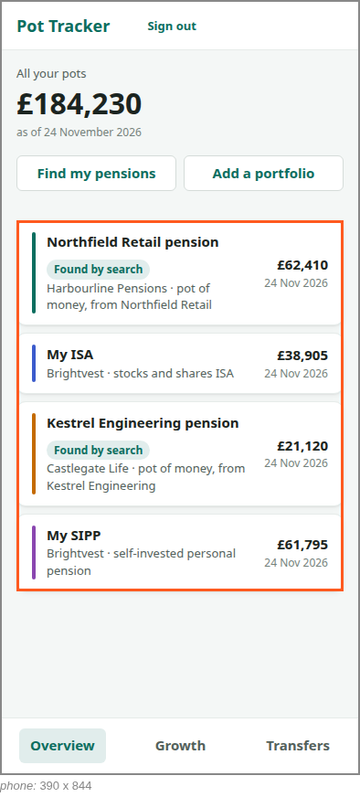

<!-- Generated by ui-walkthrough from WALKTHROUGH.yaml and STEP.yaml. Do not edit. -->
# Claim a possible match

↑ [The whole walkthrough](../WALKTHROUGH.phone.md), which is [Find my pensions: 05a Receive a possible match](../../find-my-pensions/05a-possible-match/STEP.phone.md)

[desk](STEP.desk.md) · **phone**

## 01a Say it is not theirs

| Previous | Next |
|:---|---:|
| ← *Knows it is not theirs* (clicks `CLAIM.NOT-MINE`) from [01 Choose a possible match](../01-choose/STEP.phone.md) | **End:** the possible match is dropped and the provider told. |

The saver knows the pension is not theirs, and says so. The possible match is dropped, the provider is told, and it
is gone from the overview.

### 1. Dropped, and the provider told

**Views**

* [APP](../../../views/APP/VIEW.md)
  * *shows*: [SHELL](../../../views/SHELL/VIEW.md)
    * *main*: [CLAIM](../../../views/CLAIM/VIEW.md)

* **CLAIM.BACK** (highlighted): Goes back to the overview of every pot.
* **CLAIM.DROPPED**: Says the possible match has been dropped and the provider told.

### 2. Gone from the overview

**Views**

* [APP](../../../views/APP/VIEW.md)
  * *shows*: [SHELL](../../../views/SHELL/VIEW.md)
    * *main*: [OVERVIEW](../../../views/OVERVIEW/VIEW.md)
      * *pots*: [POT-ROW](../../../views/POT-ROW/VIEW.md) × 4

* **OVERVIEW.POTS** (highlighted): A row for each pot.
