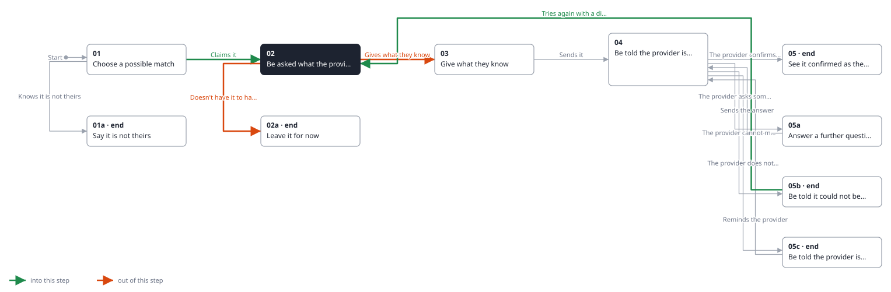
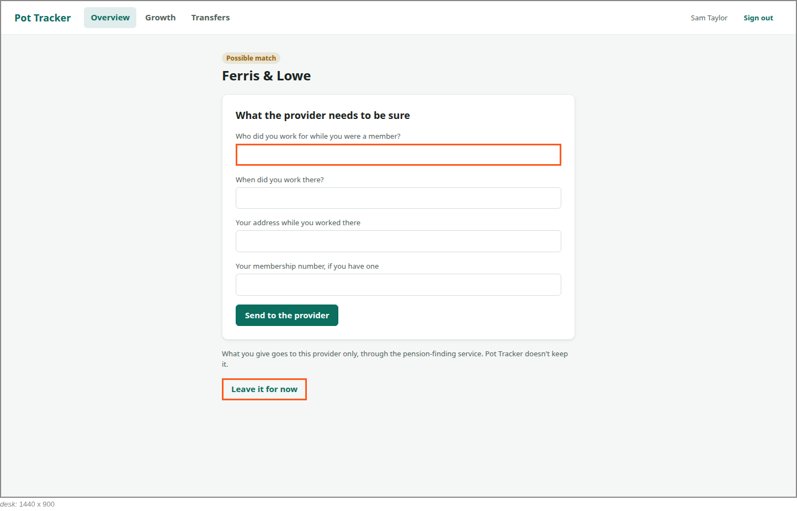

<!-- Generated by ui-walkthrough from WALKTHROUGH.yaml and STEP.yaml. Do not edit. -->
# Claim a possible match

↑ [The whole walkthrough](../WALKTHROUGH.desk.md), which is [Find my pensions: 05a Receive a possible match](../../find-my-pensions/05a-possible-match/STEP.desk.md)

**desk** · [phone](STEP.phone.md)

## 02 Be asked what the provider needs

| Previous | Next |
|:---|---:|
| ← *Claims it* (clicks `CLAIM.CLAIM`) from [01 Choose a possible match](../01-choose/STEP.desk.md) | *Gives what they know* (types in `CLAIM.EMPLOYER`): [03 Give what they know](../03-give/STEP.desk.md) → |
| ← *Tries again with a different address* (clicks `CLAIM.TRY-AGAIN`) from [05b Be told it could not be matched](../05b-not-matched/STEP.desk.md) | *Doesn't have it to hand* (clicks `CLAIM.LEAVE`): [02a Leave it for now](../02a-leave/STEP.desk.md) → |

The saver claims it, and is asked for what the provider needs to be sure. The provider decides what that is: here
the employer they worked for and when, the address they lived at then, and a membership number if they have one.
They are told what they give goes to that provider only, and Pot Tracker does not keep it.

**Views**

* [APP](../../../views/APP/VIEW.md)
  * *shows*: [SHELL](../../../views/SHELL/VIEW.md)
    * *main*: [CLAIM](../../../views/CLAIM/VIEW.md)

## In this step

* **CLAIM.EMPLOYER** (highlighted): The employer the saver worked for while a member.
* **CLAIM.LEAVE** (highlighted): Leaves it for now: the possible match waits for the saver.
* **CLAIM.ASK**: What the provider needs to be sure. The provider decides what that is.
* **CLAIM.PRIVATE**: Says what the saver gives goes to the provider only, and Pot Tracker does not keep it.
