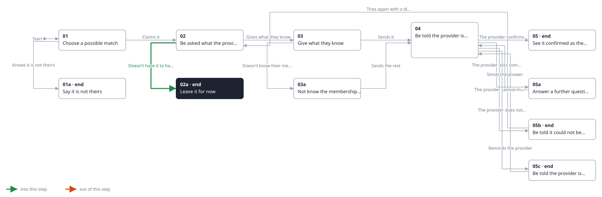
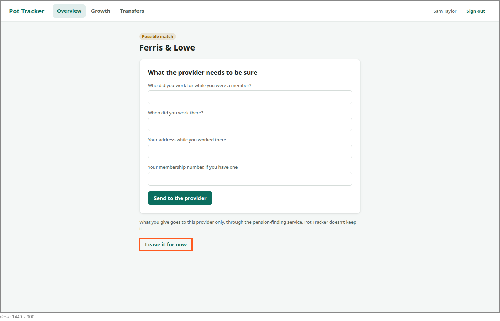
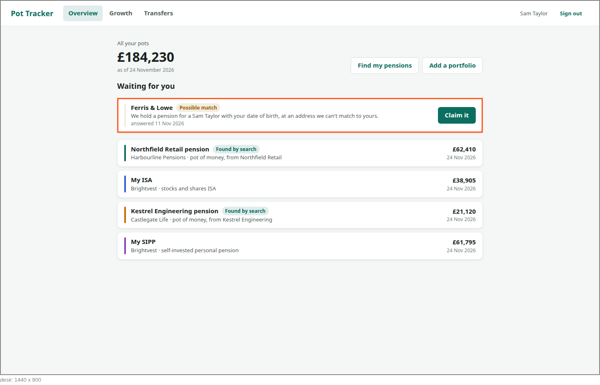

<!-- Generated by ui-walkthrough from WALKTHROUGH.yaml and STEP.yaml. Do not edit. -->
# Claim a possible match

↑ [The whole walkthrough](../WALKTHROUGH.desk.md), which is [Find my pensions: 05a Receive a possible match](../../find-my-pensions/05a-possible-match/STEP.desk.md)

**desk** · [phone](STEP.phone.md)

## 02a Leave it for now

| Previous | Next |
|:---|---:|
| ← *Doesn't have it to hand* (clicks `CLAIM.LEAVE`) from [02 Be asked what the provider needs](../02-claim/STEP.desk.md) | **End:** the possible match waits for the saver. |

The saver does not have what the provider asks for to hand, and leaves it for now. The possible match waits for
them, and is still on the overview when they next sign in.

### 1. Leaves it for now

**Views**

* [APP](../../../views/APP/VIEW.md)
  * *shows*: [SHELL](../../../views/SHELL/VIEW.md)
    * *main*: [CLAIM](../../../views/CLAIM/VIEW.md)

* **CLAIM.LEAVE** (highlighted): Leaves it for now: the possible match waits for the saver.
* **CLAIM.ASK**: What the provider needs to be sure. The provider decides what that is.

### 2. On their next sign-in, still waiting for them

**Views**

* [APP](../../../views/APP/VIEW.md)
  * *shows*: [SHELL](../../../views/SHELL/VIEW.md)
    * *main*: [OVERVIEW](../../../views/OVERVIEW/VIEW.md)
      * *pots*: [POT-ROW](../../../views/POT-ROW/VIEW.md) × 4
      * *waiting*: [POSSIBLE-MATCH](../../../views/POSSIBLE-MATCH/VIEW.md)

* **POSSIBLE-MATCH** (highlighted): A pension a provider may hold for the saver but is not sure is theirs: who the provider is, why it is not sure, and opening it to claim it. It is not a pot until the provider is sure.
* **OVERVIEW.WAITING-HEAD**: Heads the possible matches waiting for the saver.
