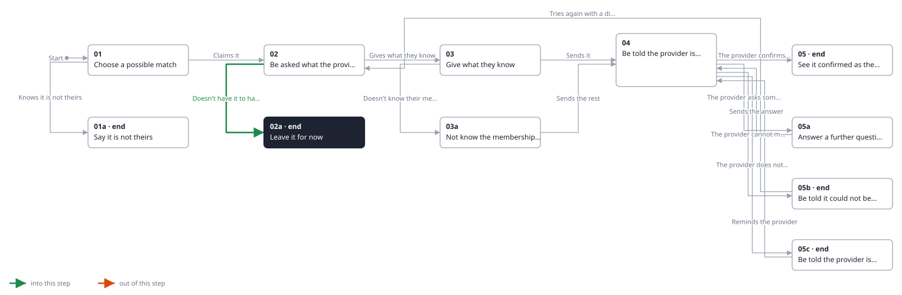
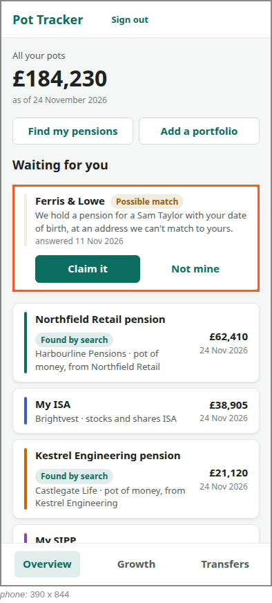

<!-- Generated by ui-walkthrough from WALKTHROUGH.yaml and STEP.yaml. Do not edit. -->
# Claim a possible match

↑ [The whole walkthrough](../WALKTHROUGH.phone.md), which is [Find my pensions: 05a Receive a possible match](../../find-my-pensions/05a-possible-match/STEP.phone.md)

[desk](STEP.desk.md) · **phone**

## 02a Leave it for now

| Previous | Next |
|:---|---:|
| ← *Doesn't have it to hand* (clicks `CLAIM.LEAVE`) from [02 Be asked what the provider needs](../02-claim/STEP.phone.md) | **End:** the possible match waits for the saver. |

The saver does not have what the provider asks for to hand, and leaves it. The possible match waits for them, and is
still on the overview when they next sign in.

**Views**

* [APP](../../../views/APP/VIEW.md)
  * *shows*: [SHELL](../../../views/SHELL/VIEW.md)
    * *main*: [OVERVIEW](../../../views/OVERVIEW/VIEW.md)
      * *pots*: [POT-ROW](../../../views/POT-ROW/VIEW.md) × 4
      * *waiting*: [POSSIBLE-MATCH](../../../views/POSSIBLE-MATCH/VIEW.md)

## In this step

* **POSSIBLE-MATCH** (highlighted): A pension a provider may hold for the saver but is not sure is theirs: who the provider is, why it is not sure, and claiming it or saying it is not theirs. It is not a pot until the provider is sure.
* **OVERVIEW.WAITING-HEAD**: Heads the possible matches waiting for the saver.
