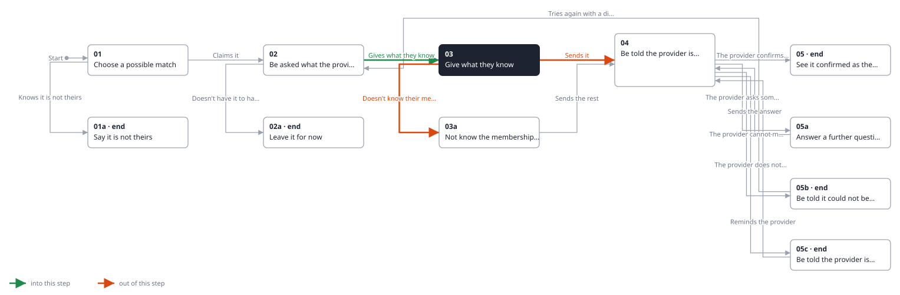
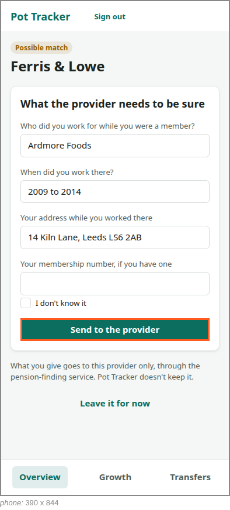

<!-- Generated by ui-walkthrough from WALKTHROUGH.yaml and STEP.yaml. Do not edit. -->
# Claim a possible match

↑ [The whole walkthrough](../WALKTHROUGH.phone.md), which is [Find my pensions: 05a Receive a possible match](../../find-my-pensions/05a-possible-match/STEP.phone.md)

[desk](STEP.desk.md) · **phone**

## 03 Give what they know

| Previous | Next |
|:---|---:|
| ← *Gives what they know* (types in `CLAIM.EMPLOYER`) from [02 Be asked what the provider needs](../02-claim/STEP.phone.md) | *Sends it* (clicks `CLAIM.SEND`): [04 Be told the provider is checking](../04-checking/STEP.phone.md) → |
|  | *Doesn't know their membership number* (clicks `CLAIM.DONT-KNOW`): [03a Not know the membership number](../03a-dont-know/STEP.phone.md) → |

The saver gives the employer, when they worked there and their address then, and sends it to the provider.

**Views**

* [APP](../../../views/APP/VIEW.md)
  * *shows*: [SHELL](../../../views/SHELL/VIEW.md)
    * *main*: [CLAIM](../../../views/CLAIM/VIEW.md)

## In this step

* **CLAIM.SEND** (highlighted): Sends what the saver gave to the provider.
* **CLAIM.EMPLOYER**: The employer the saver worked for while a member.
* **CLAIM.WHEN**: When they worked there.
* **CLAIM.ADDRESS**: The address they lived at then.
* **CLAIM.MEMBERSHIP**: Their membership number, if they have one.
