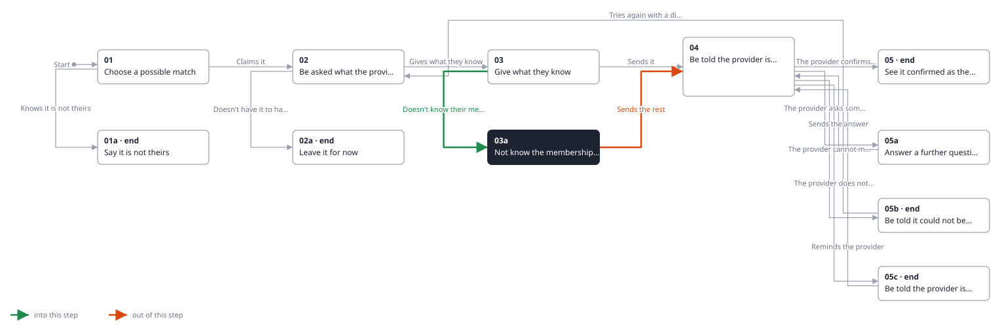
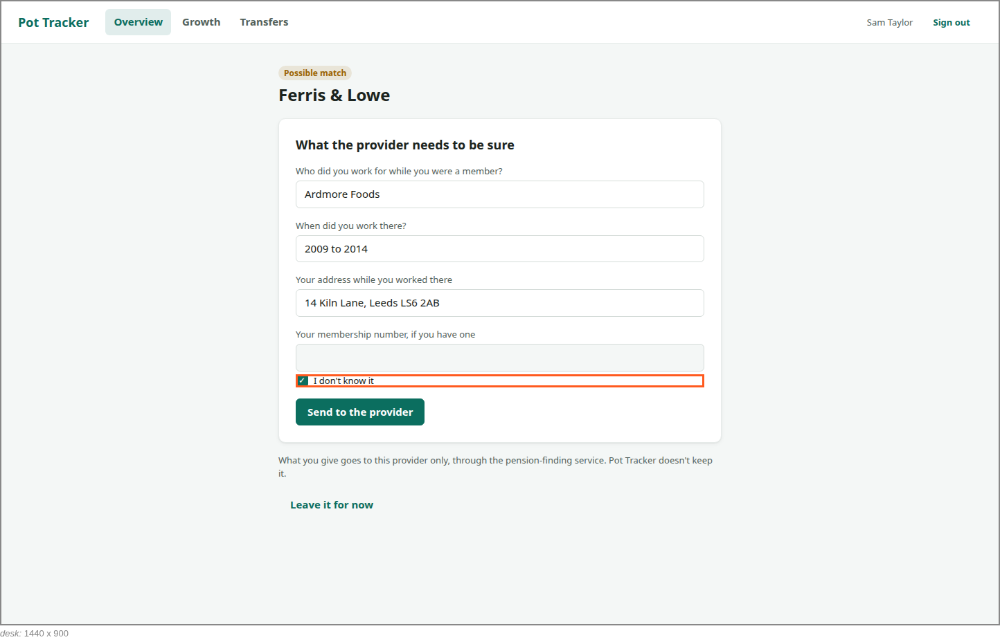

<!-- Generated by ui-walkthrough from WALKTHROUGH.yaml and STEP.yaml. Do not edit. -->
# Claim a possible match

↑ [The whole walkthrough](../WALKTHROUGH.desk.md), which is [Find my pensions: 05a Receive a possible match](../../find-my-pensions/05a-possible-match/STEP.desk.md)

**desk** · [phone](STEP.phone.md)

## 03a Not know the membership number

| Previous | Next |
|:---|---:|
| ← *Doesn't know their membership number* (clicks `CLAIM.DONT-KNOW`) from [03 Give what they know](../03-give/STEP.desk.md) | *Sends the rest* (clicks `CLAIM.SEND`): [04 Be told the provider is checking](../04-checking/STEP.desk.md) → |

The saver does not know their membership number. They say so, and send the rest.

**Views**

* [APP](../../../views/APP/VIEW.md)
  * *shows*: [SHELL](../../../views/SHELL/VIEW.md)
    * *main*: [CLAIM](../../../views/CLAIM/VIEW.md)

## In this step

* **CLAIM.DONT-KNOW** (highlighted): Says the saver does not know their membership number, so the rest is sent without it.
* **CLAIM.MEMBERSHIP**: Their membership number, if they have one.
* **CLAIM.SEND**: Sends what the saver gave to the provider.
