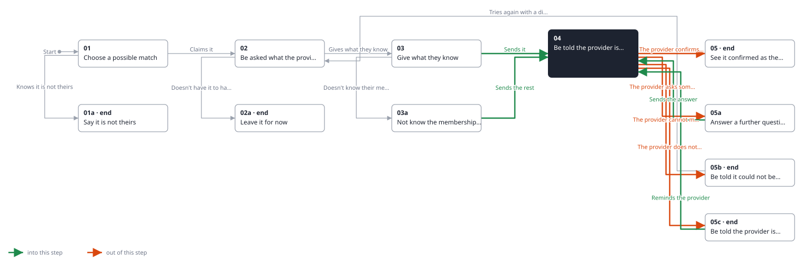
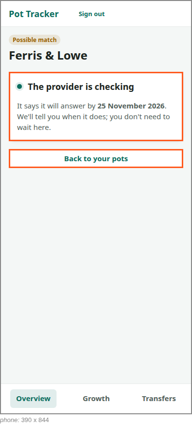
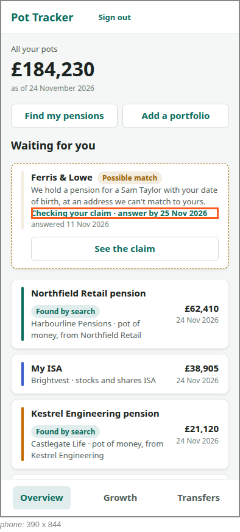

<!-- Generated by ui-walkthrough from WALKTHROUGH.yaml and STEP.yaml. Do not edit. -->
# Claim a possible match

↑ [The whole walkthrough](../WALKTHROUGH.phone.md), which is [Find my pensions: 05a Receive a possible match](../../find-my-pensions/05a-possible-match/STEP.phone.md)

[desk](STEP.desk.md) · **phone**

## 04 Be told the provider is checking

| Previous | Next |
|:---|---:|
| ← *Sends it* (clicks `CLAIM.SEND`) from [03 Give what they know](../03-give/STEP.phone.md) | *The provider confirms it is theirs* (when `provider-confirms-match` happens): [05 See it confirmed as theirs](../05-confirmed/STEP.phone.md) → |
| ← *Sends the answer* (clicks `CLAIM.SEND-ANSWER`) from [05a Answer a further question](../05a-further-question/STEP.phone.md) | *The provider asks something more* (when `provider-asks-further-question` happens): [05a Answer a further question](../05a-further-question/STEP.phone.md) → |
| ← *Reminds the provider* (clicks `CLAIM.REMIND`) from [05c Be told the provider is late](../05c-late/STEP.phone.md) | *The provider cannot match it* (when `provider-cannot-match` happens): [05b Be told it could not be matched](../05b-not-matched/STEP.phone.md) → |
|  | *The provider does not answer in time* (when `answer-date-passes` happens): [05c Be told the provider is late](../05c-late/STEP.phone.md) → |

The saver is told the provider is checking, and when it says it will answer, typically within ten working days. They
need not wait: back on the overview the possible match says it is being checked, and until when.

### 1. Told the provider is checking

**Views**

* [APP](../../../views/APP/VIEW.md)
  * *shows*: [SHELL](../../../views/SHELL/VIEW.md)
    * *main*: [CLAIM](../../../views/CLAIM/VIEW.md)

* **CLAIM.CHECKING** (highlighted): Says the provider is checking, and when it says it will answer.
* **CLAIM.BACK** (highlighted): Goes back to the overview of every pot.

### 2. Back on the overview, the claim shows as being checked

**Views**

* [APP](../../../views/APP/VIEW.md)
  * *shows*: [SHELL](../../../views/SHELL/VIEW.md)
    * *main*: [OVERVIEW](../../../views/OVERVIEW/VIEW.md)
      * *pots*: [POT-ROW](../../../views/POT-ROW/VIEW.md) × 4
      * *waiting*: [POSSIBLE-MATCH](../../../views/POSSIBLE-MATCH/VIEW.md)

* **POSSIBLE-MATCH.CHECKING** (highlighted): Says the provider is checking the saver's claim, and by when it will answer.
