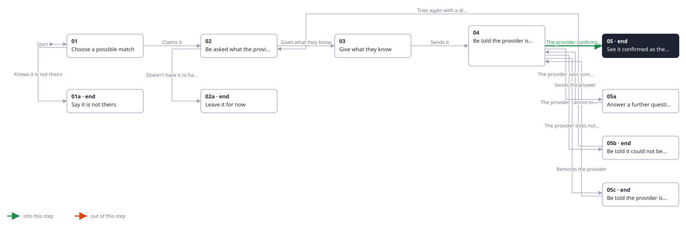
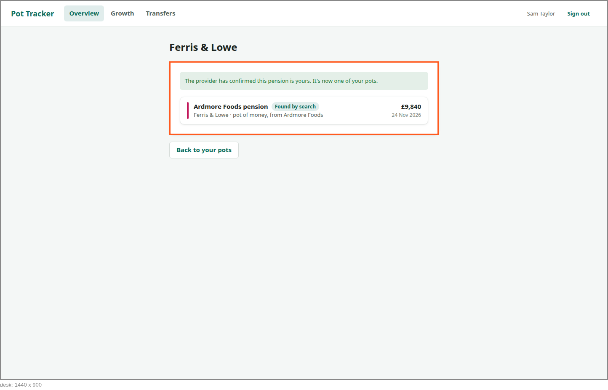
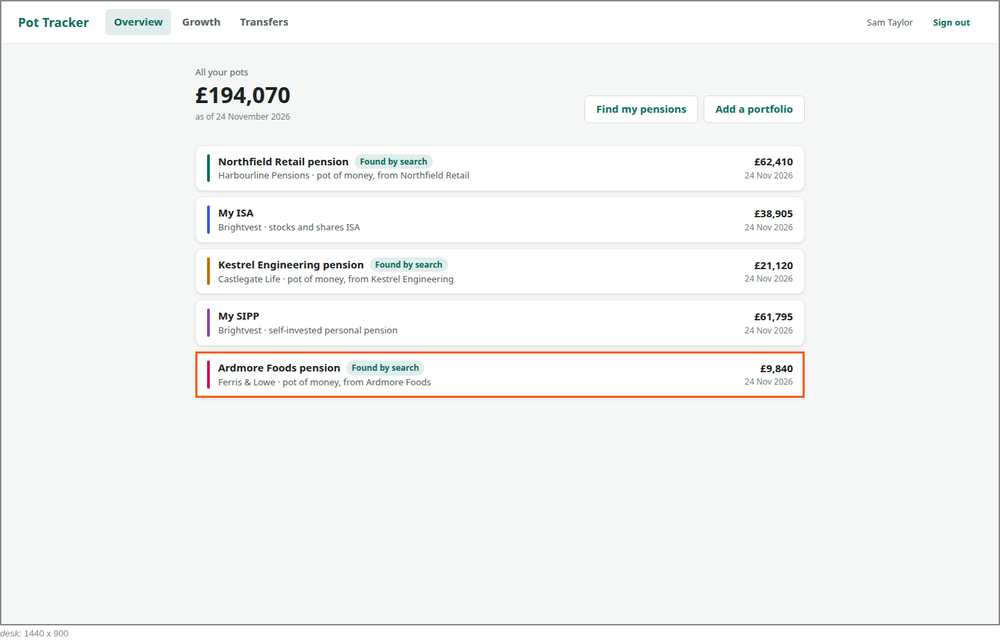

<!-- Generated by ui-walkthrough from WALKTHROUGH.yaml and STEP.yaml. Do not edit. -->
# Claim a possible match

↑ [The whole walkthrough](../WALKTHROUGH.desk.md), which is [Find my pensions: 05a Receive a possible match](../../find-my-pensions/05a-possible-match/STEP.desk.md)

**desk** · [phone](STEP.phone.md)

## 05 See it confirmed as theirs

| Previous | Next |
|:---|---:|
| ← *The provider confirms it is theirs* (when `provider-confirms-match` happens) from [04 Be told the provider is checking](../04-checking/STEP.desk.md) | **End:** the pension is one of the saver's pots. |

The provider confirms the pension is the saver's, and shares it. They are told so, and it is one of their pots, with
its value, marked as found by the search. The possible match is gone.

### 1. Told it is confirmed, and is one of their pots

**Views**

* [APP](../../../views/APP/VIEW.md)
  * *shows*: [SHELL](../../../views/SHELL/VIEW.md)
    * *main*: [CLAIM](../../../views/CLAIM/VIEW.md)
      * *pot*: [POT-ROW](../../../views/POT-ROW/VIEW.md)

* **CLAIM.CONFIRMED** (highlighted): Says the provider has confirmed the pension is the saver's, and shows it as one of their pots.

### 2. On the overview, a pot, and the possible match gone

**Views**

* [APP](../../../views/APP/VIEW.md)
  * *shows*: [SHELL](../../../views/SHELL/VIEW.md)
    * *main*: [OVERVIEW](../../../views/OVERVIEW/VIEW.md)
      * *pots*: [POT-ROW](../../../views/POT-ROW/VIEW.md) × 5

* **POT-ROW#5** (highlighted): One pot in a list: its colour, its name, its provider and kind, and its value with when that was.
* **OVERVIEW.TOTAL**: What every pot adds up to.
