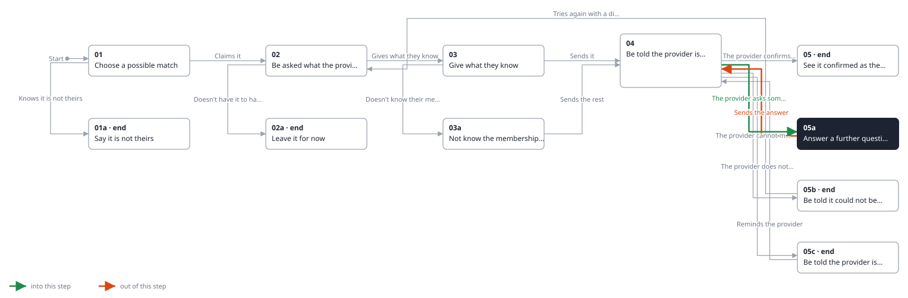
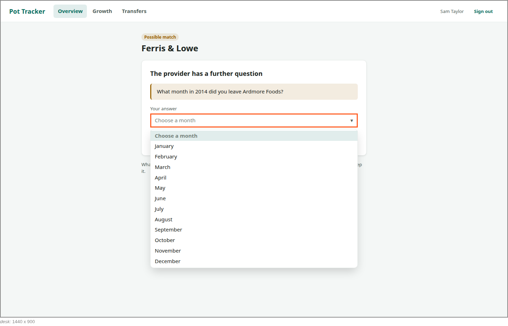
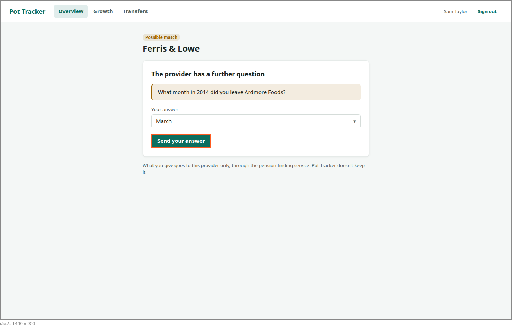

<!-- Generated by ui-walkthrough from WALKTHROUGH.yaml and STEP.yaml. Do not edit. -->
# Claim a possible match

↑ [The whole walkthrough](../WALKTHROUGH.desk.md), which is [Find my pensions: 05a Receive a possible match](../../find-my-pensions/05a-possible-match/STEP.desk.md)

**desk** · [phone](STEP.phone.md)

## 05a Answer a further question

| Previous | Next |
|:---|---:|
| ← *The provider asks something more* (when `provider-asks-further-question` happens) from [04 Be told the provider is checking](../04-checking/STEP.desk.md) | *Sends the answer* (clicks `CLAIM.SEND-ANSWER`): [04 Be told the provider is checking](../04-checking/STEP.desk.md) → |

The provider needs more, and asks a further question: here, which month in 2014 the saver left, offering the
months to choose from. They are told, choose their answer and send it, and the provider checks again.

### 1. Asked which month, with the months to choose from

**Views**

* [APP](../../../views/APP/VIEW.md)
  * *shows*: [SHELL](../../../views/SHELL/VIEW.md)
    * *main*: [CLAIM](../../../views/CLAIM/VIEW.md)

* **CLAIM.ANSWER** (highlighted): The saver's answer, chosen from those the provider offers.
* **CLAIM.QUESTION**: The provider's question.

### 2. Chooses March and sends it

**Views**

* [APP](../../../views/APP/VIEW.md)
  * *shows*: [SHELL](../../../views/SHELL/VIEW.md)
    * *main*: [CLAIM](../../../views/CLAIM/VIEW.md)

* **CLAIM.SEND-ANSWER** (highlighted): Sends the answer to the provider.
* **CLAIM.ANSWER**: The saver's answer, chosen from those the provider offers.
