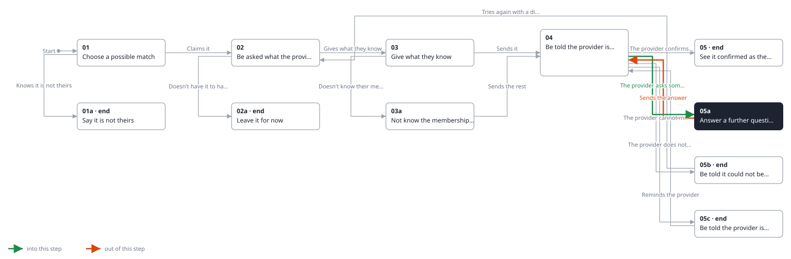
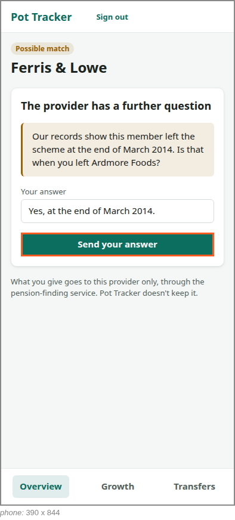

<!-- Generated by ui-walkthrough from WALKTHROUGH.yaml and STEP.yaml. Do not edit. -->
# Claim a possible match

↑ [The whole walkthrough](../WALKTHROUGH.phone.md), which is [Find my pensions: 05a Receive a possible match](../../find-my-pensions/05a-possible-match/STEP.phone.md)

[desk](STEP.desk.md) · **phone**

## 05a Answer a further question

| Previous | Next |
|:---|---:|
| ← *The provider asks something more* (when `provider-asks-further-question` happens) from [04 Be told the provider is checking](../04-checking/STEP.phone.md) | *Sends the answer* (clicks `CLAIM.SEND-ANSWER`): [04 Be told the provider is checking](../04-checking/STEP.phone.md) → |

The provider needs more, and asks a further question: here, to confirm when the saver left. They are told, and
answer it, and the provider checks again.

**Views**

* [APP](../../../views/APP/VIEW.md)
  * *shows*: [SHELL](../../../views/SHELL/VIEW.md)
    * *main*: [CLAIM](../../../views/CLAIM/VIEW.md)

## In this step

* **CLAIM.SEND-ANSWER** (highlighted): Sends the answer to the provider.
* **CLAIM.QUESTION**: The provider's question.
* **CLAIM.ANSWER**: The saver's answer.
