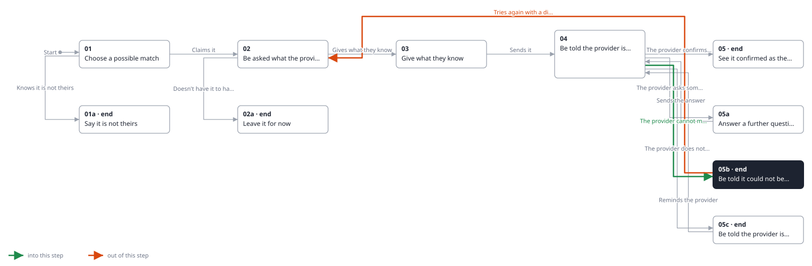
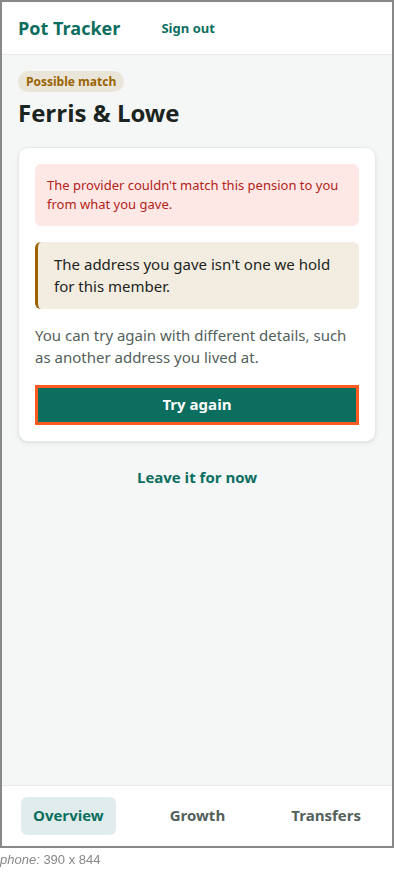

<!-- Generated by ui-walkthrough from WALKTHROUGH.yaml and STEP.yaml. Do not edit. -->
# Claim a possible match

↑ [The whole walkthrough](../WALKTHROUGH.phone.md), which is [Find my pensions: 05a Receive a possible match](../../find-my-pensions/05a-possible-match/STEP.phone.md)

[desk](STEP.desk.md) · **phone**

## 05b Be told it could not be matched

| Previous | Next |
|:---|---:|
| ← *The provider cannot match it* (when `provider-cannot-match` happens) from [04 Be told the provider is checking](../04-checking/STEP.phone.md) | *Tries again with a different address* (clicks `CLAIM.TRY-AGAIN`): [02 Be asked what the provider needs](../02-claim/STEP.phone.md) → |
|  | **End:** the possible match waits for the saver. |

The provider cannot match the pension to the saver from what they gave. They are told so, and why, as the provider
says, and may try again with different details, such as another address, or leave it.

**Views**

* [APP](../../../views/APP/VIEW.md)
  * *shows*: [SHELL](../../../views/SHELL/VIEW.md)
    * *main*: [CLAIM](../../../views/CLAIM/VIEW.md)

## In this step

* **CLAIM.TRY-AGAIN** (highlighted): Goes back to giving the provider what it asks for, to try different details.
* **CLAIM.NOT-MATCHED**: Says the provider could not match the pension to the saver, and why if it says.
* **CLAIM.WHY**: Why, in the provider's words.
* **CLAIM.LEAVE**: Leaves it for now: the possible match waits for the saver.
