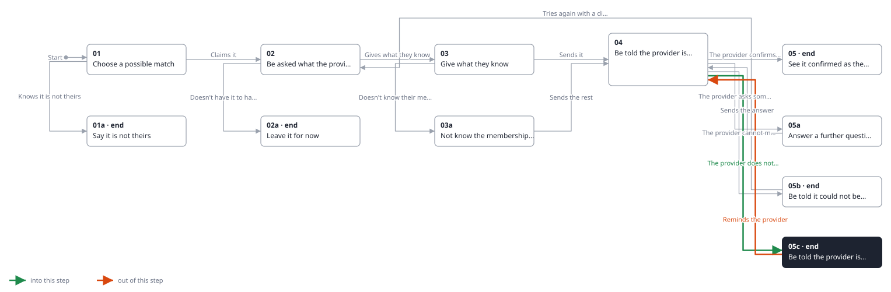
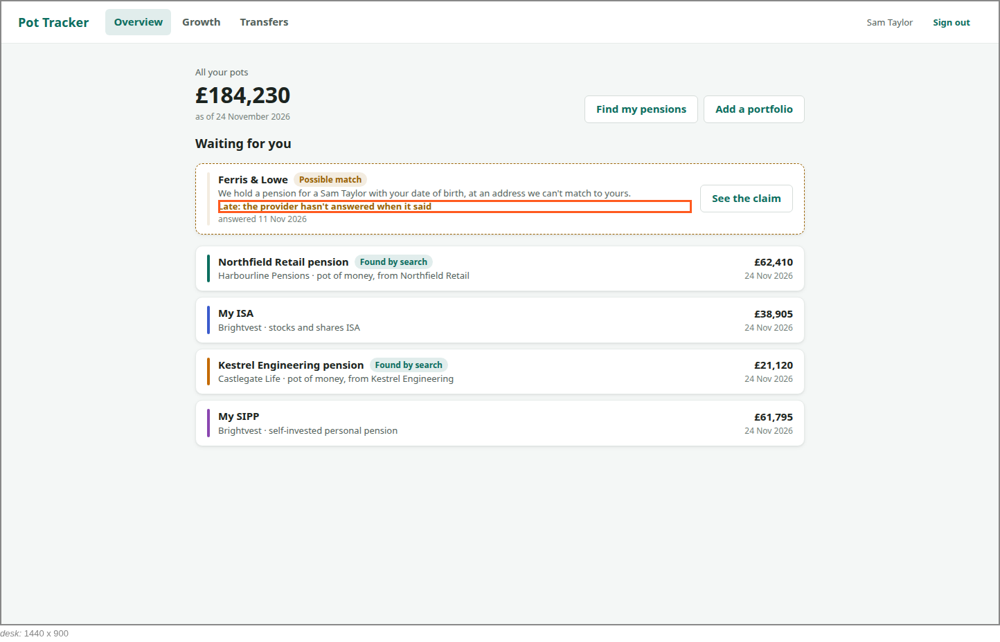
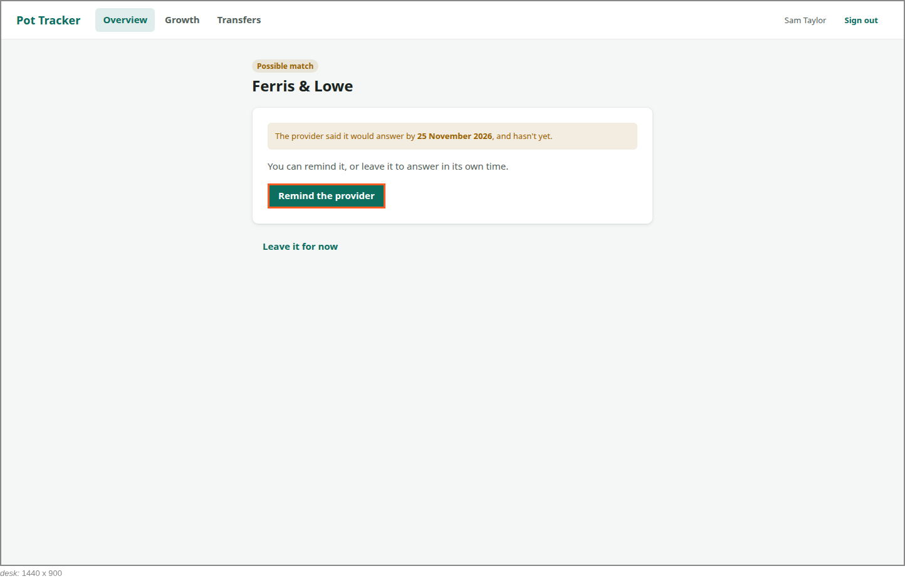

<!-- Generated by ui-walkthrough from WALKTHROUGH.yaml and STEP.yaml. Do not edit. -->
# Claim a possible match

↑ [The whole walkthrough](../WALKTHROUGH.desk.md), which is [Find my pensions: 05a Receive a possible match](../../find-my-pensions/05a-possible-match/STEP.desk.md)

**desk** · [phone](STEP.phone.md)

## 05c Be told the provider is late

| Previous | Next |
|:---|---:|
| ← *The provider does not answer in time* (when `answer-date-passes` happens) from [04 Be told the provider is checking](../04-checking/STEP.desk.md) | *Reminds the provider* (clicks `CLAIM.REMIND`): [04 Be told the provider is checking](../04-checking/STEP.desk.md) → |
|  | **End:** the claim waits on the provider. |

The provider has not answered by when it said. The possible match on the overview says it is late, and on the claim
the saver may remind the provider, or leave it to answer in its own time.

### 1. On the overview, the claim says it is late

**Views**

* [APP](../../../views/APP/VIEW.md)
  * *shows*: [SHELL](../../../views/SHELL/VIEW.md)
    * *main*: [OVERVIEW](../../../views/OVERVIEW/VIEW.md)
      * *pots*: [POT-ROW](../../../views/POT-ROW/VIEW.md) × 4
      * *waiting*: [POSSIBLE-MATCH](../../../views/POSSIBLE-MATCH/VIEW.md)

* **POSSIBLE-MATCH.LATE** (highlighted): Says the provider has not answered by when it said.

### 2. On the claim, a reminder to send, or leave it

**Views**

* [APP](../../../views/APP/VIEW.md)
  * *shows*: [SHELL](../../../views/SHELL/VIEW.md)
    * *main*: [CLAIM](../../../views/CLAIM/VIEW.md)

* **CLAIM.REMIND** (highlighted): Reminds the provider to answer.
* **CLAIM.LATE**: Says the provider has not answered by when it said it would.
* **CLAIM.LEAVE**: Leaves it for now: the possible match waits for the saver.
