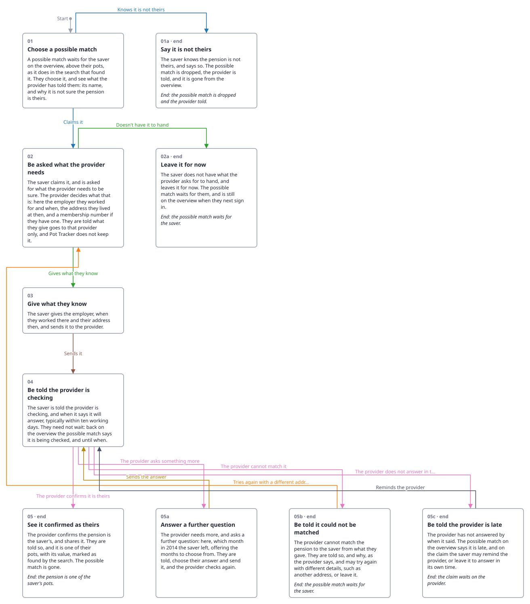

<!-- Generated by ui-walkthrough from WALKTHROUGH.yaml. Do not edit. -->
# Claim a possible match

Describes [Claim A Possible Match](../../../use-cases/claim-a-possible-match/USE-CASE.md).

↑ This walkthrough is [Find my pensions: 05a Receive a possible match](../find-my-pensions/05a-possible-match/STEP.phone.md)

[desk](WALKTHROUGH.desk.md) · **phone**

## Steps

* [01 Choose a possible match](01-choose/STEP.phone.md): a way in, *Start*
* [01a Say it is not theirs](01a-not-mine/STEP.phone.md): ends the walkthrough
* [02 Be asked what the provider needs](02-claim/STEP.phone.md)
* [02a Leave it for now](02a-leave/STEP.phone.md): ends the walkthrough
* [03 Give what they know](03-give/STEP.phone.md)
* [03a Not know the membership number](03a-dont-know/STEP.phone.md)
* [04 Be told the provider is checking](04-checking/STEP.phone.md)
* [05 See it confirmed as theirs](05-confirmed/STEP.phone.md): ends the walkthrough
* [05a Answer a further question](05a-further-question/STEP.phone.md)
* [05b Be told it could not be matched](05b-not-matched/STEP.phone.md): may end the walkthrough
* [05c Be told the provider is late](05c-late/STEP.phone.md): may end the walkthrough
