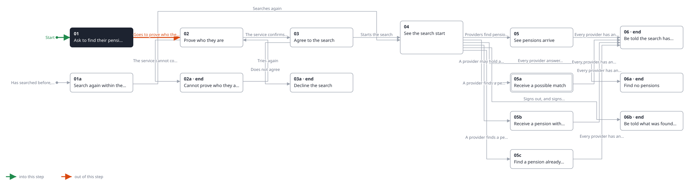

<!-- Generated by ui-walkthrough from WALKTHROUGH.yaml and STEP.yaml. Do not edit. -->
# Find my pensions

↑ [The whole walkthrough](../WALKTHROUGH.phone.md)

[desk](STEP.desk.md) · **phone**

## 01 Ask to find their pensions

| Previous | Next |
|:---|---:|
| *Start* | *Asks to find their pensions* (clicks `OVERVIEW.FIND-PENSIONS`): [02 Prove who they are](../02-prove/STEP.phone.md) → |
|  | *Asks, having searched within the year* (clicks `OVERVIEW.FIND-PENSIONS`): [01a Search again within the year](../01a-searched-before/STEP.phone.md) → |

From the overview of their pots, the saver asks to find their pensions.

**Views**

* [APP](../../../views/APP/VIEW.md)
  * *shows*: [SHELL](../../../views/SHELL/VIEW.md)
    * *main*: [OVERVIEW](../../../views/OVERVIEW/VIEW.md)
      * *pots*: [POT-ROW](../../../views/POT-ROW/VIEW.md) × 2

## In this step

* **OVERVIEW.FIND-PENSIONS** (highlighted): Starts finding the saver's pensions, or more of them.
