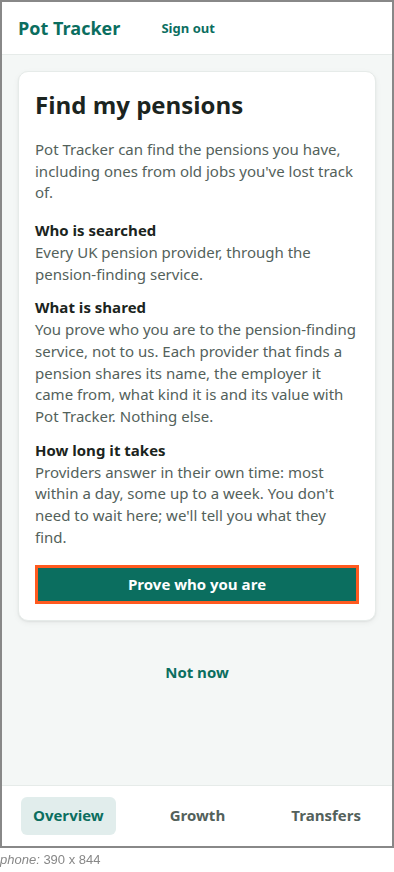

<!-- Generated by ui-walkthrough from WALKTHROUGH.yaml and STEP.yaml. Do not edit. -->
# Find my pensions

↑ [The whole walkthrough](../WALKTHROUGH.phone.md)

[desk](STEP.desk.md) · **phone**

## 01 Ask to find their pensions

| Previous | Next |
|:---|---:|
| *Start* | *Goes to prove who they are* (clicks `FIND-PENSIONS.PROVE`): [02 Prove who they are](../02-prove/STEP.phone.md) → |

From the overview of their pots, the saver asks to find their pensions. Before anything happens they are told what
will: every UK pension provider is searched, through the pension-finding service; they prove who they are to the
service, not to Pot Tracker; and providers answer over days, not seconds.

### 1. From the overview of their pots

**Views**

* [APP](../../../views/APP/VIEW.md)
  * *shows*: [SHELL](../../../views/SHELL/VIEW.md)
    * *main*: [OVERVIEW](../../../views/OVERVIEW/VIEW.md)
      * *pots*: [POT-ROW](../../../views/POT-ROW/VIEW.md) × 2

* **OVERVIEW.FIND-PENSIONS** (highlighted): Starts finding the saver's pensions, or more of them.

### 2. Told what will happen, before anything does

**Views**

* [APP](../../../views/APP/VIEW.md)
  * *shows*: [SHELL](../../../views/SHELL/VIEW.md)
    * *main*: [FIND-PENSIONS](../../../views/FIND-PENSIONS/VIEW.md)

* **FIND-PENSIONS.PROVE** (highlighted): Goes to the pension-finding service, in a window of its own, to prove who the saver is.
* **FIND-PENSIONS.EXPLAIN**: Says what will happen: who is searched, what is shared and with whom, and that answers take days.
