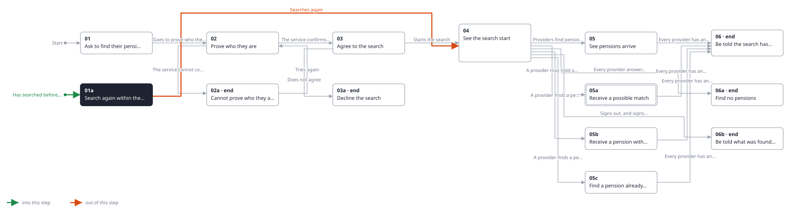
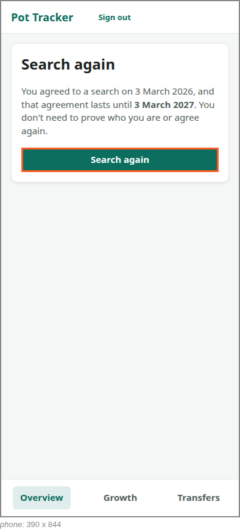

<!-- Generated by ui-walkthrough from WALKTHROUGH.yaml and STEP.yaml. Do not edit. -->
# Find my pensions

↑ [The whole walkthrough](../WALKTHROUGH.phone.md)

[desk](STEP.desk.md) · **phone**

## 01a Search again within the year

| Previous | Next |
|:---|---:|
| *Has searched before, and their consent has not ended* | *Searches again* (clicks `FIND-PENSIONS.SEARCH-AGAIN`): [04 See the search start](../04-started/STEP.phone.md) → |

The saver searched before, and the consent they gave then has not ended. They are told when they agreed and until
when, and search again without proving who they are or agreeing again.

**Views**

* [APP](../../../views/APP/VIEW.md)
  * *shows*: [SHELL](../../../views/SHELL/VIEW.md)
    * *main*: [FIND-PENSIONS](../../../views/FIND-PENSIONS/VIEW.md)

## In this step

* **FIND-PENSIONS.SEARCH-AGAIN** (highlighted): Starts the search again under the consent already given.
* **FIND-PENSIONS.AGAIN**: For a saver whose consent has not ended: says when they agreed and until when, so they need not prove who they are or agree again.
