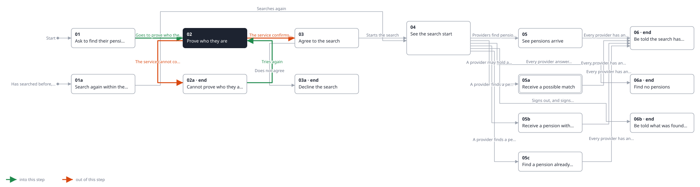
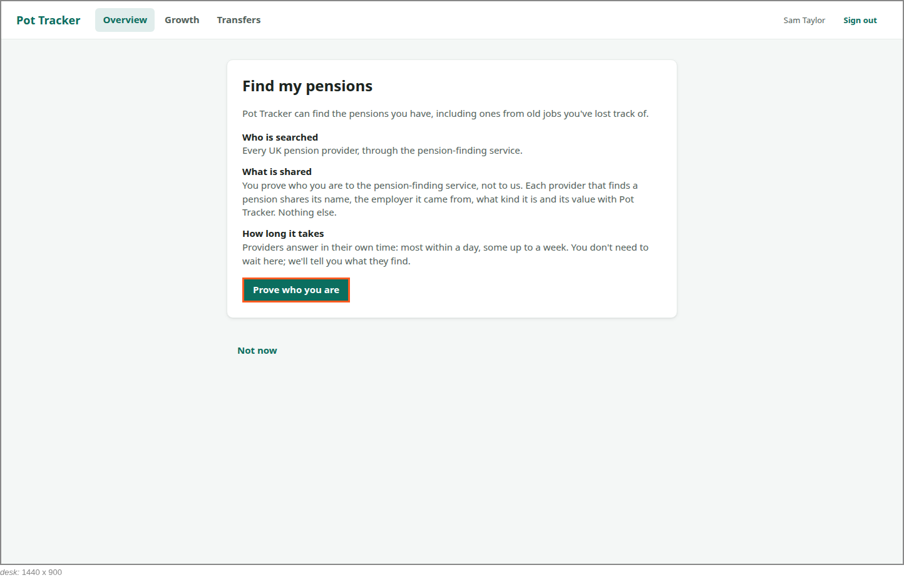
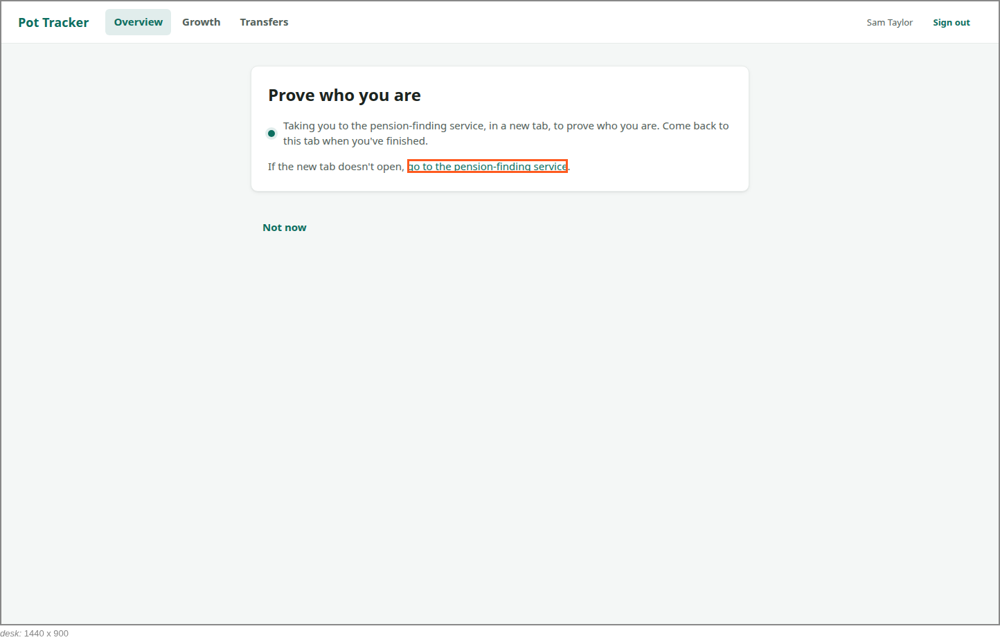
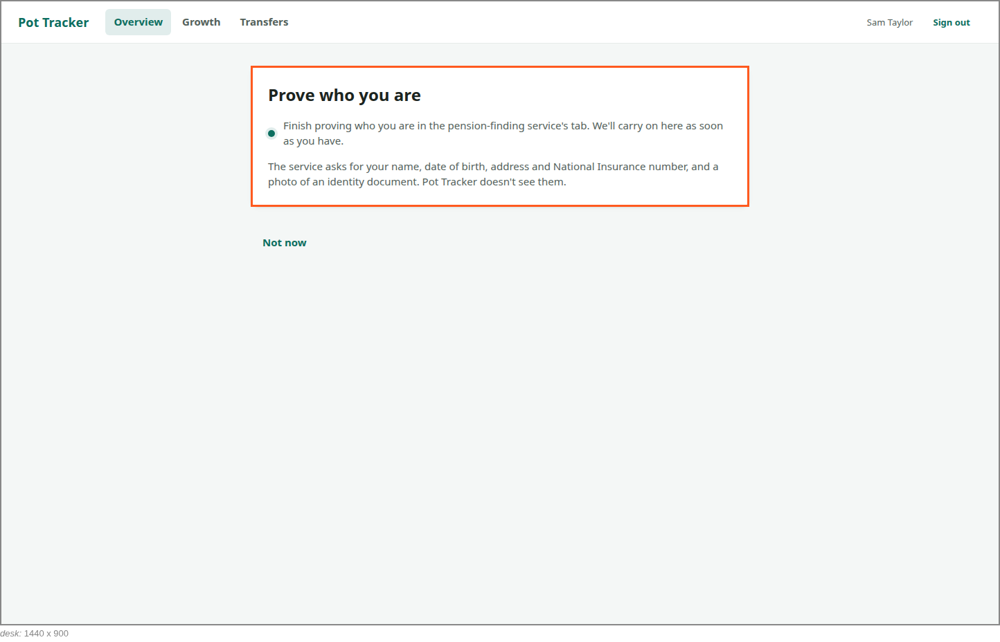

<!-- Generated by ui-walkthrough from WALKTHROUGH.yaml and STEP.yaml. Do not edit. -->
# Find my pensions

↑ [The whole walkthrough](../WALKTHROUGH.desk.md)

**desk** · [phone](STEP.phone.md)

## 02 Prove who they are

| Previous | Next |
|:---|---:|
| ← *Asks to find their pensions* (clicks `OVERVIEW.FIND-PENSIONS`) from [01 Ask to find their pensions](../01-ask/STEP.desk.md) | *The service confirms who they are* (when `identity-confirmed` happens): [03 Agree to the search](../03-agree/STEP.desk.md) → |
| ← *Tries again* (clicks `FIND-PENSIONS.TRY-AGAIN`) from [02a Cannot prove who they are](../02a-not-proved/STEP.desk.md) | *The service cannot confirm who they are* (when `identity-not-confirmed` happens): [02a Cannot prove who they are](../02a-not-proved/STEP.desk.md) → |

Before anything happens the saver is told what will: every UK pension provider is searched, through the
pension-finding service; they prove who they are to the service, not to Pot Tracker; and providers answer over days,
not seconds. Going on, they are told the service is opening in a new tab, with a link to follow if it does not. Its
identity check is not this UI's: Pot Tracker waits, saying what the service will ask for and that it never sees it,
and carries on when the service says whether it succeeded.

### 1. Told what will happen, before anything does

**Views**

* [APP](../../../views/APP/VIEW.md)
  * *shows*: [SHELL](../../../views/SHELL/VIEW.md)
    * *main*: [FIND-PENSIONS](../../../views/FIND-PENSIONS/VIEW.md)

* **FIND-PENSIONS.PROVE** (highlighted): Goes to the pension-finding service, in a window of its own, to prove who the saver is.
* **FIND-PENSIONS.EXPLAIN**: Says what will happen: who is searched, what is shared and with whom, and that answers take days.

### 2. Taken to the service in a new tab, with a link if it does not open

**Views**

* [APP](../../../views/APP/VIEW.md)
  * *shows*: [SHELL](../../../views/SHELL/VIEW.md)
    * *main*: [FIND-PENSIONS](../../../views/FIND-PENSIONS/VIEW.md)

* **FIND-PENSIONS.OPEN-SERVICE** (highlighted): Opens the pension-finding service's tab, for a saver whose tab did not open by itself.
* **FIND-PENSIONS.REDIRECTING**: Says the saver is being taken to the pension-finding service in a new tab to prove who they are, with a link to follow if it does not open.

### 3. Proving who they are in the service's tab, while Pot Tracker waits

**Views**

* [APP](../../../views/APP/VIEW.md)
  * *shows*: [SHELL](../../../views/SHELL/VIEW.md)
    * *main*: [FIND-PENSIONS](../../../views/FIND-PENSIONS/VIEW.md)

* **FIND-PENSIONS.PROVING** (highlighted): Says the saver is proving who they are in the service's window, and that Pot Tracker carries on when they have.
