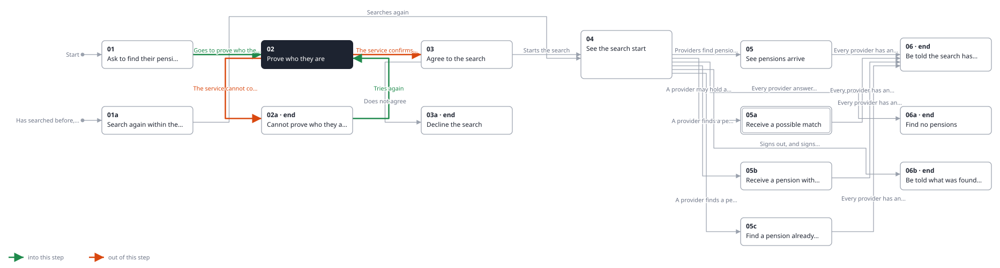
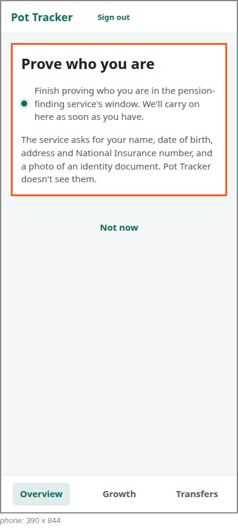

<!-- Generated by ui-walkthrough from WALKTHROUGH.yaml and STEP.yaml. Do not edit. -->
# Find my pensions

↑ [The whole walkthrough](../WALKTHROUGH.phone.md)

[desk](STEP.desk.md) · **phone**

## 02 Prove who they are

| Previous | Next |
|:---|---:|
| ← *Goes to prove who they are* (clicks `FIND-PENSIONS.PROVE`) from [01 Ask to find their pensions](../01-ask/STEP.phone.md) | *The service confirms who they are* (when `identity-confirmed` happens): [03 Agree to the search](../03-agree/STEP.phone.md) → |
| ← *Tries again* (clicks `FIND-PENSIONS.TRY-AGAIN`) from [02a Cannot prove who they are](../02a-not-proved/STEP.phone.md) | *The service cannot confirm who they are* (when `identity-not-confirmed` happens): [02a Cannot prove who they are](../02a-not-proved/STEP.phone.md) → |

The saver proves who they are to the pension-finding service, in its own window: its identity check is not this
UI's. Pot Tracker waits, saying what the service will ask for and that it never sees it, and carries on when the
service says whether it succeeded.

**Views**

* [APP](../../../views/APP/VIEW.md)
  * *shows*: [SHELL](../../../views/SHELL/VIEW.md)
    * *main*: [FIND-PENSIONS](../../../views/FIND-PENSIONS/VIEW.md)

## In this step

* **FIND-PENSIONS.PROVING** (highlighted): Says the saver is proving who they are in the service's window, and that Pot Tracker carries on when they have.
