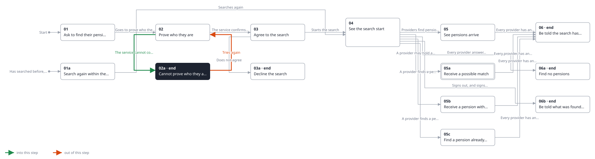
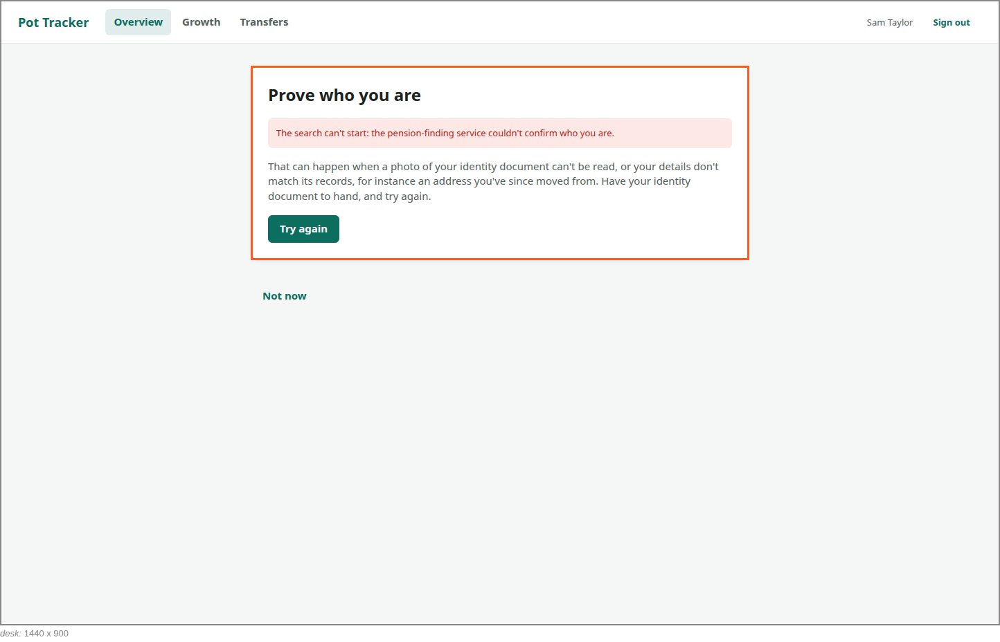

<!-- Generated by ui-walkthrough from WALKTHROUGH.yaml and STEP.yaml. Do not edit. -->
# Find my pensions

↑ [The whole walkthrough](../WALKTHROUGH.desk.md)

**desk** · [phone](STEP.phone.md)

## 02a Cannot prove who they are

| Previous | Next |
|:---|---:|
| ← *The service cannot confirm who they are* (when `identity-not-confirmed` happens) from [02 Prove who they are](../02-prove/STEP.desk.md) | *Tries again* (clicks `FIND-PENSIONS.TRY-AGAIN`): [02 Prove who they are](../02-prove/STEP.desk.md) → |
|  | **End:** the search has not started. |

The service could not confirm who the saver is. Pot Tracker sees only that, not why, so it says what commonly
causes it and how to try again. No search starts.

**Views**

* [APP](../../../views/APP/VIEW.md)
  * *shows*: [SHELL](../../../views/SHELL/VIEW.md)
    * *main*: [FIND-PENSIONS](../../../views/FIND-PENSIONS/VIEW.md)

## In this step

* **FIND-PENSIONS.NOT-PROVED** (highlighted): Says the search cannot start because the service could not confirm who the saver is, why that can happen, and how to try again.
* **FIND-PENSIONS.TRY-AGAIN**: Goes back to the service to prove who the saver is again.
