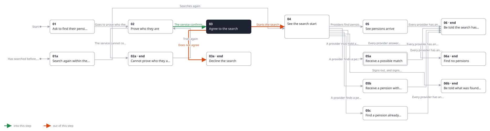
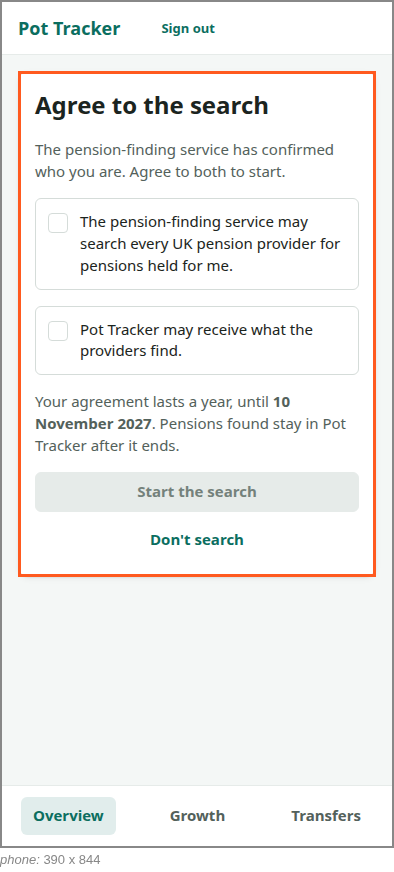
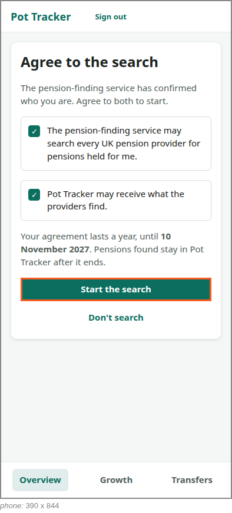

<!-- Generated by ui-walkthrough from WALKTHROUGH.yaml and STEP.yaml. Do not edit. -->
# Find my pensions

↑ [The whole walkthrough](../WALKTHROUGH.phone.md)

[desk](STEP.desk.md) · **phone**

## 03 Agree to the search

| Previous | Next |
|:---|---:|
| ← *The service confirms who they are* (when `identity-confirmed` happens) from [02 Prove who they are](../02-prove/STEP.phone.md) | *Starts the search* (clicks `FIND-PENSIONS.AGREE`): [04 See the search start](../04-started/STEP.phone.md) → |
|  | *Does not agree* (clicks `FIND-PENSIONS.DECLINE`): [03a Decline the search](../03a-declined/STEP.phone.md) → |

The saver agrees to two things, separately: that the service may search for their pensions, and that Pot Tracker may
receive what it finds. They are told the agreement lasts a year, and until when. The search starts only once both
are agreed.

### 1. Asked for the two agreements

**Views**

* [APP](../../../views/APP/VIEW.md)
  * *shows*: [SHELL](../../../views/SHELL/VIEW.md)
    * *main*: [FIND-PENSIONS](../../../views/FIND-PENSIONS/VIEW.md)

* **FIND-PENSIONS.CONSENT** (highlighted): Asks for the two agreements, separately, and says how long they last.
* **FIND-PENSIONS.AGREE-SEARCH**: The saver agrees the service may search every UK pension provider for their pensions.
* **FIND-PENSIONS.AGREE-SHARE**: The saver agrees Pot Tracker may receive what the providers share.
* **FIND-PENSIONS.AGREE**: Starts the search; only once the saver has agreed to both.

### 2. Both agreed, so the search can start

**Views**

* [APP](../../../views/APP/VIEW.md)
  * *shows*: [SHELL](../../../views/SHELL/VIEW.md)
    * *main*: [FIND-PENSIONS](../../../views/FIND-PENSIONS/VIEW.md)

* **FIND-PENSIONS.AGREE** (highlighted): Starts the search; only once the saver has agreed to both.
* **FIND-PENSIONS.DECLINE**: Declines: no search is made and nothing is shared.
