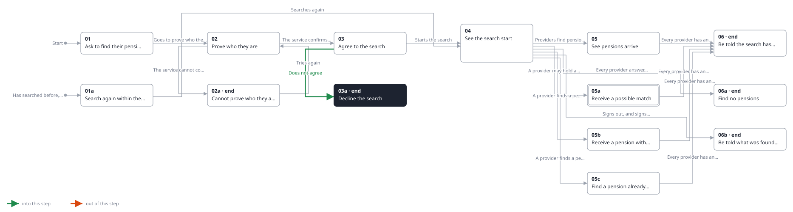
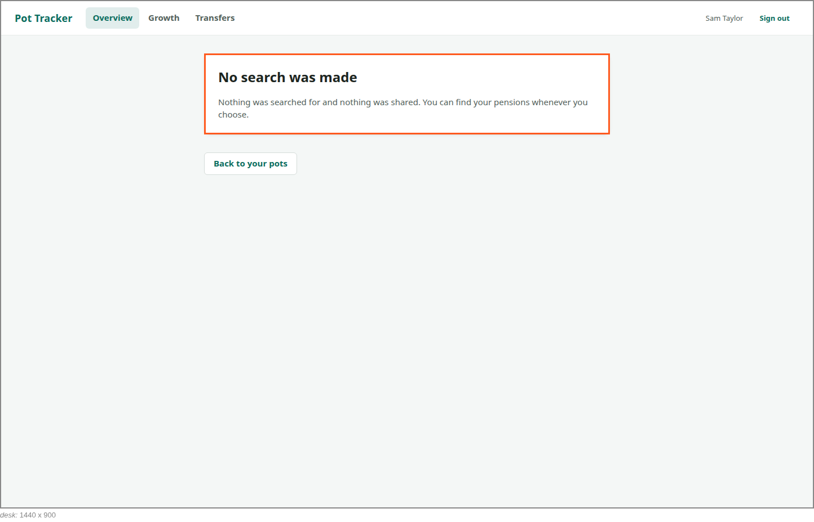

<!-- Generated by ui-walkthrough from WALKTHROUGH.yaml and STEP.yaml. Do not edit. -->
# Find my pensions

↑ [The whole walkthrough](../WALKTHROUGH.desk.md)

**desk** · [phone](STEP.phone.md)

## 03a Decline the search

| Previous | Next |
|:---|---:|
| ← *Does not agree* (clicks `FIND-PENSIONS.DECLINE`) from [03 Agree to the search](../03-agree/STEP.desk.md) | **End:** no search was made and nothing was shared. |

The saver does not agree. No search is made and nothing is shared, and they are told so.

**Views**

* [APP](../../../views/APP/VIEW.md)
  * *shows*: [SHELL](../../../views/SHELL/VIEW.md)
    * *main*: [FIND-PENSIONS](../../../views/FIND-PENSIONS/VIEW.md)

## In this step

* **FIND-PENSIONS.DECLINED** (highlighted): Says no search was made and nothing was shared.
* **FIND-PENSIONS.BACK**: Goes back to the overview of every pot.
