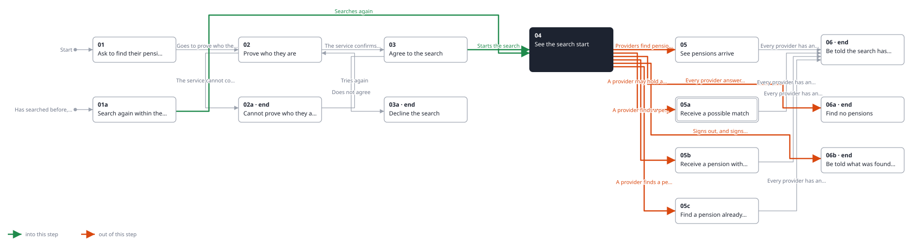
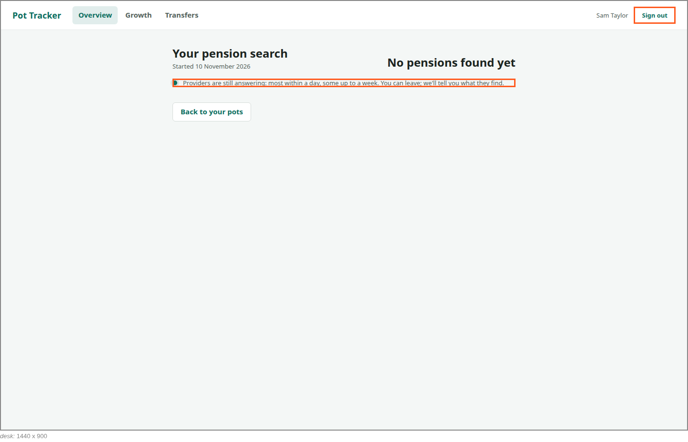

<!-- Generated by ui-walkthrough from WALKTHROUGH.yaml and STEP.yaml. Do not edit. -->
# Find my pensions

↑ [The whole walkthrough](../WALKTHROUGH.desk.md)

**desk** · [phone](STEP.phone.md)

## 04 See the search start

| Previous | Next |
|:---|---:|
| ← *Searches again* (clicks `FIND-PENSIONS.SEARCH-AGAIN`) from [01a Search again within the year](../01a-searched-before/STEP.desk.md) | *Providers find pensions* (when `provider-finds-pension` happens): [05 See pensions arrive](../05-pensions-arrive/STEP.desk.md) → |
| ← *Starts the search* (clicks `FIND-PENSIONS.AGREE`) from [03 Agree to the search](../03-agree/STEP.desk.md) | *A provider may hold a pension* (when `provider-finds-possible-match` happens): [05a Receive a possible match](../05a-possible-match/STEP.desk.md) → |
|  | *A provider finds a pension, with no value yet* (when `provider-finds-pension-without-value` happens): [05b Receive a pension with no value yet](../05b-no-value-yet/STEP.desk.md) → |
|  | *A provider finds a pension already added* (when `provider-finds-pension-already-added` happens): [05c Find a pension already added](../05c-already-added/STEP.desk.md) → |
|  | *Every provider answers with nothing* (when `search-finds-nothing` happens): [06a Find no pensions](../06a-none-found/STEP.desk.md) → |
|  | *Signs out, and signs in days later* (clicks `SHELL.SIGN-OUT`): [06b Be told what was found while away](../06b-told-on-sign-in/STEP.desk.md) → |

The search starts, and the saver is told it has, and when. It is not a wait on a spinner: they are told that
providers answer over days, that they need not stay, and that they will be told what is found.

**Views**

* [APP](../../../views/APP/VIEW.md)
  * *shows*: [SHELL](../../../views/SHELL/VIEW.md)
    * *main*: [FIND-PENSIONS](../../../views/FIND-PENSIONS/VIEW.md)

## In this step

* **FIND-PENSIONS.ARRIVING** (highlighted): Says answers arrive over days, that the saver can leave, and that they will be told what is found.
* **SHELL.SIGN-OUT** (highlighted): Signs the saver out of this device.
* **FIND-PENSIONS.SEARCH**: The search: when it started, how many pensions have been found, and that answers keep arriving.
