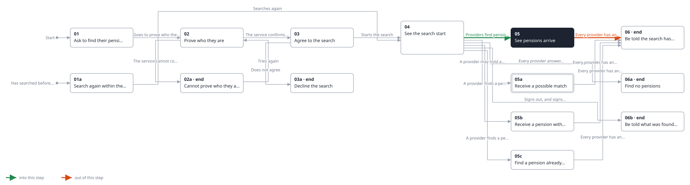
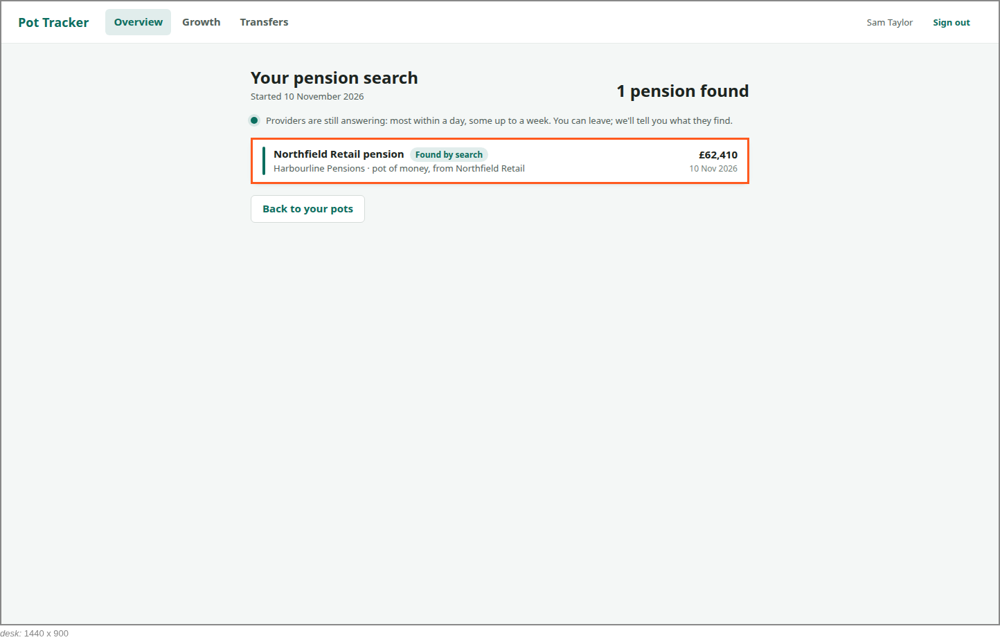
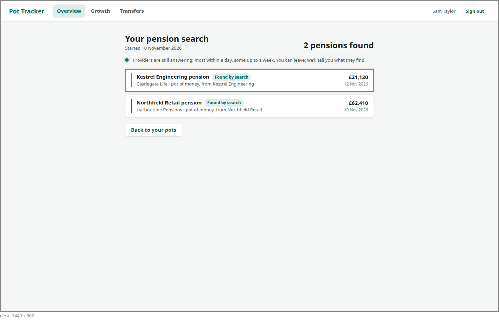

<!-- Generated by ui-walkthrough from WALKTHROUGH.yaml and STEP.yaml. Do not edit. -->
# Find my pensions

↑ [The whole walkthrough](../WALKTHROUGH.desk.md)

**desk** · [phone](STEP.phone.md)

## 05 See pensions arrive

| Previous | Next |
|:---|---:|
| ← *Providers find pensions* (when `provider-finds-pension` happens) from [04 See the search start](../04-started/STEP.desk.md) | *Every provider has answered* (when `search-finished` happens): [06 Be told the search has finished](../06-finished/STEP.desk.md) → |

As each provider answers, its pension is added to the saver's pots, newest first: the provider, the employer it came
from, that it is a pot of money, and its value with its date. Each is marked as found by the search, and the count
goes up.

### 1. The first provider answers the same day

**Views**

* [APP](../../../views/APP/VIEW.md)
  * *shows*: [SHELL](../../../views/SHELL/VIEW.md)
    * *main*: [FIND-PENSIONS](../../../views/FIND-PENSIONS/VIEW.md)
      * *found*: [POT-ROW](../../../views/POT-ROW/VIEW.md)

* **POT-ROW** (highlighted): One pot in a list: its colour, its name, its provider and kind, and its value with when that was.
* **FIND-PENSIONS.FOUND-COUNT**: How many pensions have been found so far.

### 2. Another answers two days later

**Views**

* [APP](../../../views/APP/VIEW.md)
  * *shows*: [SHELL](../../../views/SHELL/VIEW.md)
    * *main*: [FIND-PENSIONS](../../../views/FIND-PENSIONS/VIEW.md)
      * *found*: [POT-ROW](../../../views/POT-ROW/VIEW.md) × 2

* **POT-ROW#1** (highlighted): One pot in a list: its colour, its name, its provider and kind, and its value with when that was.
* **FIND-PENSIONS.FOUND-COUNT**: How many pensions have been found so far.
