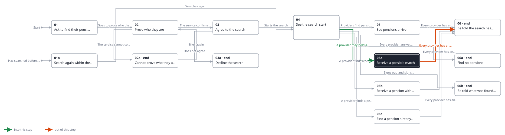
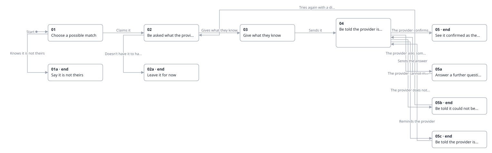
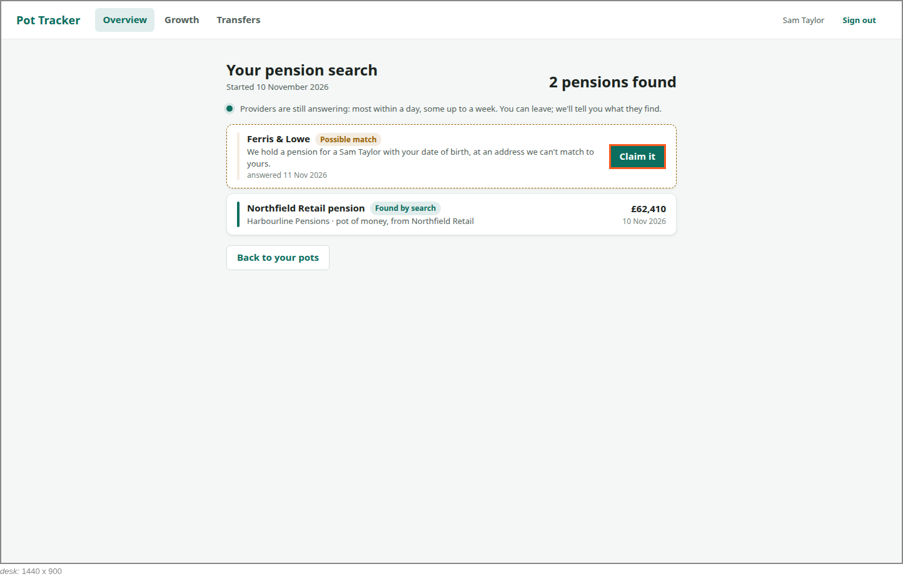

<!-- Generated by ui-walkthrough from WALKTHROUGH.yaml and STEP.yaml. Do not edit. -->
# Find my pensions

↑ [The whole walkthrough](../WALKTHROUGH.desk.md)

**desk** · [phone](STEP.phone.md)

## 05a Receive a possible match

| Previous | Next |
|:---|---:|
| ← *A provider may hold a pension* (when `provider-finds-possible-match` happens) from [04 See the search start](../04-started/STEP.desk.md) | *Every provider has answered* (when `search-finished` happens): [06 Be told the search has finished](../06-finished/STEP.desk.md) → |

**This step is the walkthrough** [Claim a possible match](../../claim-a-possible-match/WALKTHROUGH.desk.md).

A provider can only say it may hold a pension for the saver. It is listed as a possible match, not a pot, with the
provider's reason for not being sure, for the saver to claim when they choose. The search carries on.

**Views**

* [APP](../../../views/APP/VIEW.md)
  * *shows*: [SHELL](../../../views/SHELL/VIEW.md)
    * *main*: [FIND-PENSIONS](../../../views/FIND-PENSIONS/VIEW.md)
      * *found*:
        * [POSSIBLE-MATCH](../../../views/POSSIBLE-MATCH/VIEW.md)
        * [POT-ROW](../../../views/POT-ROW/VIEW.md)

## In this step

* **POSSIBLE-MATCH.CLAIM** (highlighted): Opens the possible match: why the provider is not sure, and claiming it or saying it is not the saver's.
* **POSSIBLE-MATCH**: A pension a provider may hold for the saver but is not sure is theirs: who the provider is, why it is not sure, and opening it to claim it. It is not a pot until the provider is sure.
* **POSSIBLE-MATCH.REASON**: Why the provider is not sure, in its own words.
