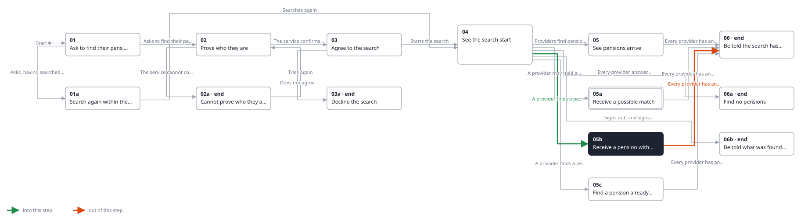
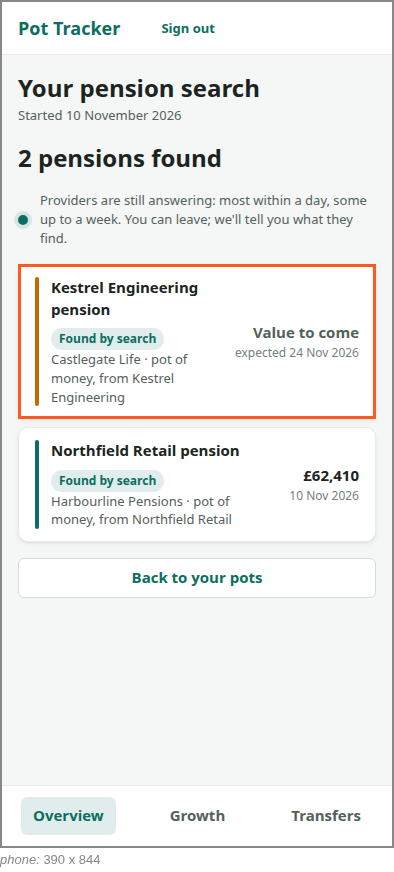

<!-- Generated by ui-walkthrough from WALKTHROUGH.yaml and STEP.yaml. Do not edit. -->
# Find my pensions

↑ [The whole walkthrough](../WALKTHROUGH.phone.md)

[desk](STEP.desk.md) · **phone**

## 05b Receive a pension with no value yet

| Previous | Next |
|:---|---:|
| ← *A provider finds a pension, with no value yet* (when `provider-finds-pension-without-value` happens) from [04 See the search start](../04-started/STEP.phone.md) | *Every provider has answered* (when `search-finished` happens): [06 Be told the search has finished](../06-finished/STEP.phone.md) → |

A provider has found the pension but cannot give its value yet. It is added as a pot with no value, saying when one
is expected.

**Views**

* [APP](../../../views/APP/VIEW.md)
  * *shows*: [SHELL](../../../views/SHELL/VIEW.md)
    * *main*: [FIND-PENSIONS](../../../views/FIND-PENSIONS/VIEW.md)
      * *found*: [POT-ROW](../../../views/POT-ROW/VIEW.md) × 2

## In this step

* **POT-ROW#1** (highlighted): One pot in a list: its colour, its name, its provider and kind, and its value with when that was.
* **POT-ROW#1.AWAITING**: Says the value is still to come, in place of a value.
* **POT-ROW#1.EXPECTED**: Says the date is when a value is expected.
