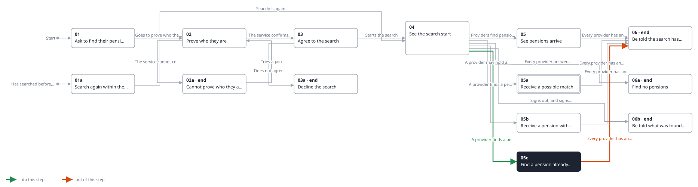

<!-- Generated by ui-walkthrough from WALKTHROUGH.yaml and STEP.yaml. Do not edit. -->
# Find my pensions

↑ [The whole walkthrough](../WALKTHROUGH.phone.md)

[desk](STEP.desk.md) · **phone**

## 05c Find a pension already added

| Previous | Next |
|:---|---:|
| ← *A provider finds a pension already added* (when `provider-finds-pension-already-added` happens) from [04 See the search start](../04-started/STEP.phone.md) | *Every provider has answered* (when `search-finished` happens): [06 Be told the search has finished](../06-finished/STEP.phone.md) → |

The search finds the SIPP the saver had already added by hand as a portfolio. It is not added twice: the pot they
added is marked as found by the search too.

**Views**

* [APP](../../../views/APP/VIEW.md)
  * *shows*: [SHELL](../../../views/SHELL/VIEW.md)
    * *main*: [FIND-PENSIONS](../../../views/FIND-PENSIONS/VIEW.md)
      * *found*: [POT-ROW](../../../views/POT-ROW/VIEW.md) × 2

## In this step

* **POT-ROW#1.MATCHED** (highlighted): Says the search found a pot the saver had already added, so it was not added twice.
* **POT-ROW#1.FOUND**: Marks a pot the pension search found.
