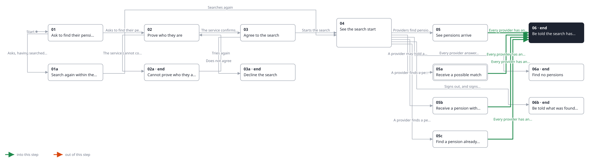
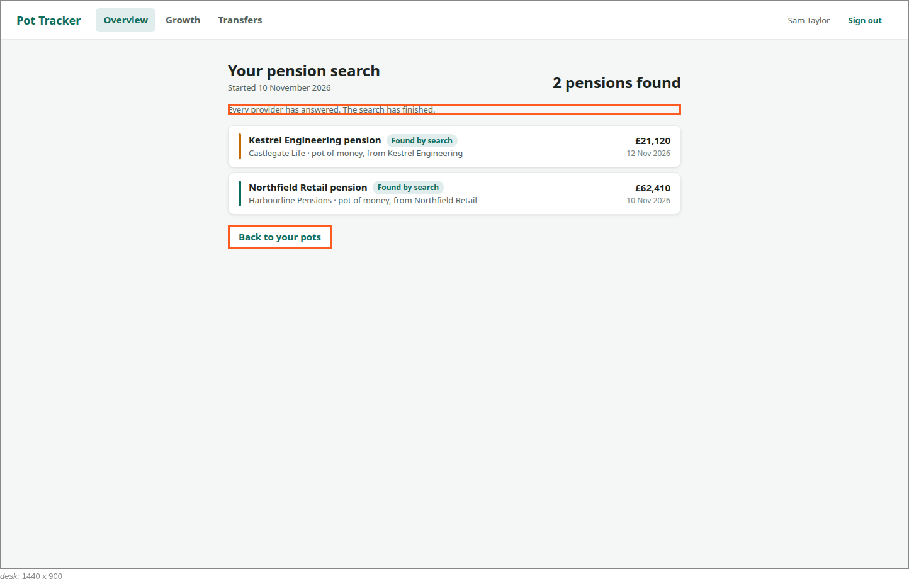
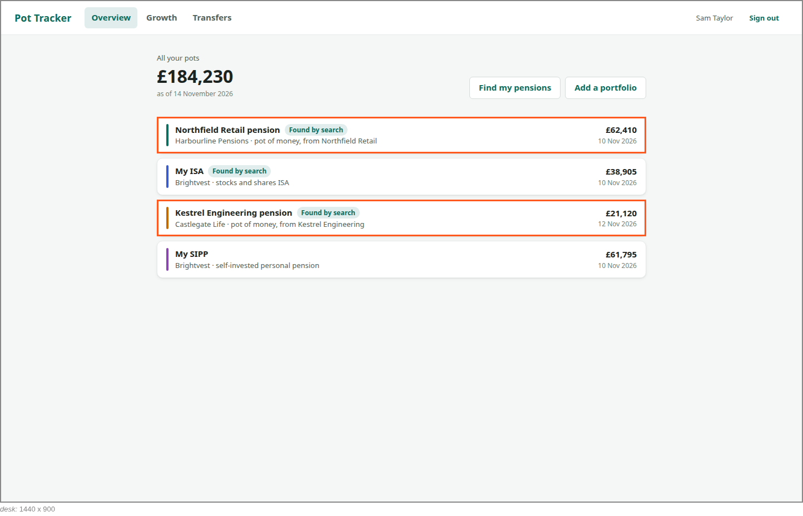

<!-- Generated by ui-walkthrough from WALKTHROUGH.yaml and STEP.yaml. Do not edit. -->
# Find my pensions

↑ [The whole walkthrough](../WALKTHROUGH.desk.md)

**desk** · [phone](STEP.phone.md)

## 06 Be told the search has finished

| Previous | Next |
|:---|---:|
| ← *Every provider has answered* (when `search-finished` happens) from [05 See pensions arrive](../05-pensions-arrive/STEP.desk.md) | **End:** every pension found is one of the saver's pots. |
| ← *Every provider has answered* (when `search-finished` happens) from [05a Receive a possible match](../05a-possible-match/STEP.desk.md) |  |
| ← *Every provider has answered* (when `search-finished` happens) from [05b Receive a pension with no value yet](../05b-no-value-yet/STEP.desk.md) |  |
| ← *Every provider has answered* (when `search-finished` happens) from [05c Find a pension already added](../05c-already-added/STEP.desk.md) |  |

Every provider has answered. The saver is told the search has finished and how many pensions it found, and back on
the overview the pots it found are among their pots, each marked so.

### 1. Told the search has finished

**Views**

* [APP](../../../views/APP/VIEW.md)
  * *shows*: [SHELL](../../../views/SHELL/VIEW.md)
    * *main*: [FIND-PENSIONS](../../../views/FIND-PENSIONS/VIEW.md)
      * *found*: [POT-ROW](../../../views/POT-ROW/VIEW.md) × 2

* **FIND-PENSIONS.FINISHED** (highlighted): Says the search has finished.
* **FIND-PENSIONS.BACK** (highlighted): Goes back to the overview of every pot.
* **FIND-PENSIONS.FOUND-COUNT**: How many pensions have been found so far.

### 2. Back on the overview, the pensions found are among their pots

**Views**

* [APP](../../../views/APP/VIEW.md)
  * *shows*: [SHELL](../../../views/SHELL/VIEW.md)
    * *main*: [OVERVIEW](../../../views/OVERVIEW/VIEW.md)
      * *pots*: [POT-ROW](../../../views/POT-ROW/VIEW.md) × 4

* **POT-ROW#1** (highlighted): One pot in a list: its colour, its name, its provider and kind, and its value with when that was.
* **POT-ROW#3** (highlighted): One pot in a list: its colour, its name, its provider and kind, and its value with when that was.
