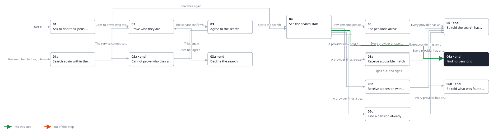
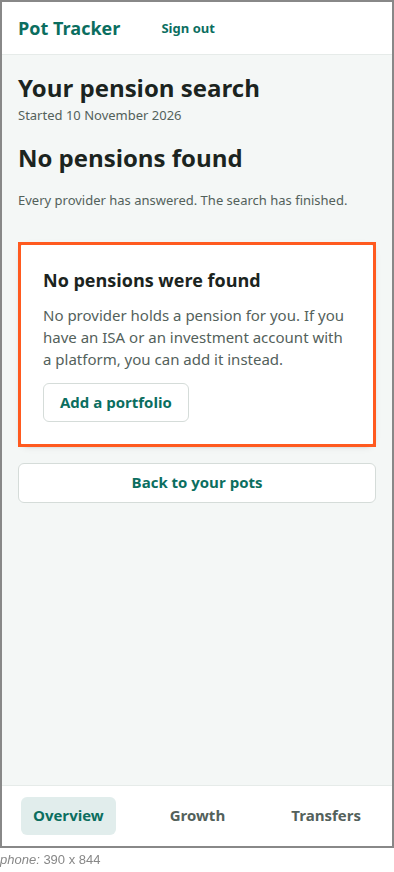

<!-- Generated by ui-walkthrough from WALKTHROUGH.yaml and STEP.yaml. Do not edit. -->
# Find my pensions

↑ [The whole walkthrough](../WALKTHROUGH.phone.md)

[desk](STEP.desk.md) · **phone**

## 06a Find no pensions

| Previous | Next |
|:---|---:|
| ← *Every provider answers with nothing* (when `search-finds-nothing` happens) from [04 See the search start](../04-started/STEP.phone.md) | **End:** no pension was found, and adding a portfolio is offered. |

Every provider answered with nothing. The saver is told no pension was found, and offered adding an ISA or
investment account instead.

**Views**

* [APP](../../../views/APP/VIEW.md)
  * *shows*: [SHELL](../../../views/SHELL/VIEW.md)
    * *main*: [FIND-PENSIONS](../../../views/FIND-PENSIONS/VIEW.md)

## In this step

* **FIND-PENSIONS.NONE** (highlighted): Says no pension was found, and offers adding an investment portfolio instead.
* **FIND-PENSIONS.FINISHED**: Says the search has finished.
* **FIND-PENSIONS.ADD-PORTFOLIO**: Starts adding an investment portfolio, when no pension was found.
