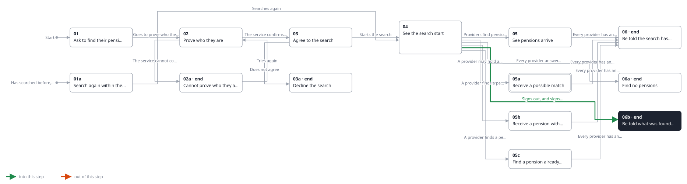
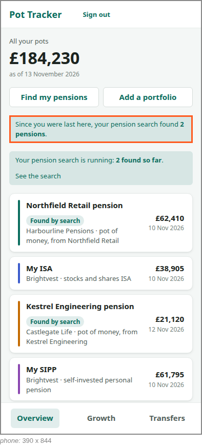

<!-- Generated by ui-walkthrough from WALKTHROUGH.yaml and STEP.yaml. Do not edit. -->
# Find my pensions

↑ [The whole walkthrough](../WALKTHROUGH.phone.md)

[desk](STEP.desk.md) · **phone**

## 06b Be told what was found while away

| Previous | Next |
|:---|---:|
| ← *Signs out, and signs in days later* (clicks `SHELL.SIGN-OUT`) from [04 See the search start](../04-started/STEP.phone.md) | **End:** the saver knows what the search found while they were away. |

The saver signed out while the search ran. Answers kept arriving, and when they next sign in the overview tells
them how many pensions were found since they were last there, and that the search is still running.

**Views**

* [APP](../../../views/APP/VIEW.md)
  * *shows*: [SHELL](../../../views/SHELL/VIEW.md)
    * *main*: [OVERVIEW](../../../views/OVERVIEW/VIEW.md)
      * *pots*: [POT-ROW](../../../views/POT-ROW/VIEW.md) × 4

## In this step

* **OVERVIEW.SINCE** (highlighted): On signing in, says how many pensions the search found since the saver was last there.
* **OVERVIEW.SEARCHING**: Says a pension search is running and how many it has found so far, and goes to it.
* **POT-ROW#1.FOUND**: Marks a pot the pension search found.
