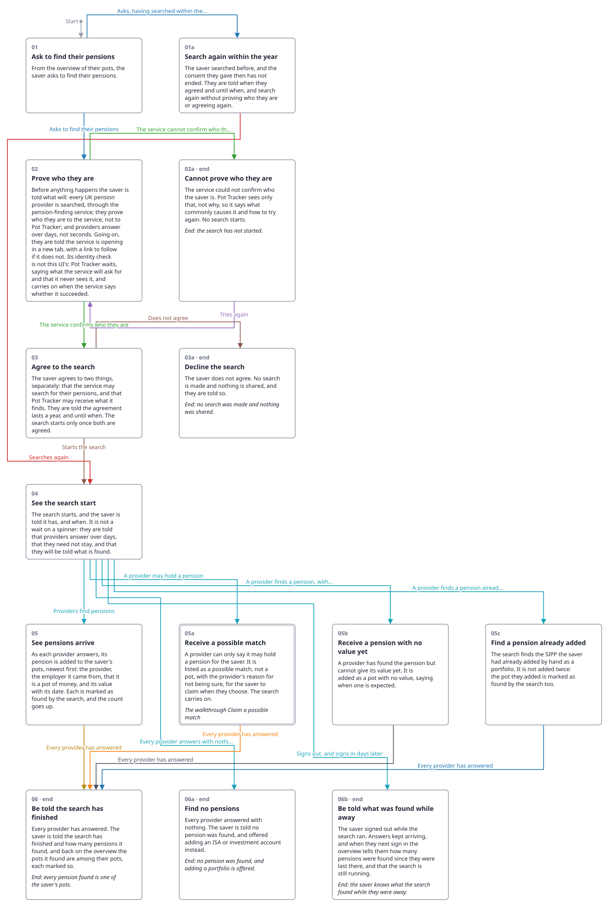

<!-- Generated by ui-walkthrough from WALKTHROUGH.yaml. Do not edit. -->
# Find my pensions

Describes [Find My Pensions](../../../use-cases/find-my-pensions/USE-CASE.md).

**desk** · [phone](WALKTHROUGH.phone.md)

## Steps

* [01 Ask to find their pensions](01-ask/STEP.desk.md): a way in, *Start*
* [01a Search again within the year](01a-searched-before/STEP.desk.md): a way in, *Has searched before, and their consent has not ended*
* [02 Prove who they are](02-prove/STEP.desk.md)
* [02a Cannot prove who they are](02a-not-proved/STEP.desk.md): may end the walkthrough
* [03 Agree to the search](03-agree/STEP.desk.md)
* [03a Decline the search](03a-declined/STEP.desk.md): ends the walkthrough
* [04 See the search start](04-started/STEP.desk.md)
* [05 See pensions arrive](05-pensions-arrive/STEP.desk.md)
* [05a Receive a possible match](05a-possible-match/STEP.desk.md): the walkthrough `analysis/ui/walkthroughs/claim-a-possible-match`, *not written yet*
* [05b Receive a pension with no value yet](05b-no-value-yet/STEP.desk.md)
* [05c Find a pension already added](05c-already-added/STEP.desk.md)
* [06 Be told the search has finished](06-finished/STEP.desk.md): ends the walkthrough
* [06a Find no pensions](06a-none-found/STEP.desk.md): ends the walkthrough
* [06b Be told what was found while away](06b-told-on-sign-in/STEP.desk.md): ends the walkthrough
