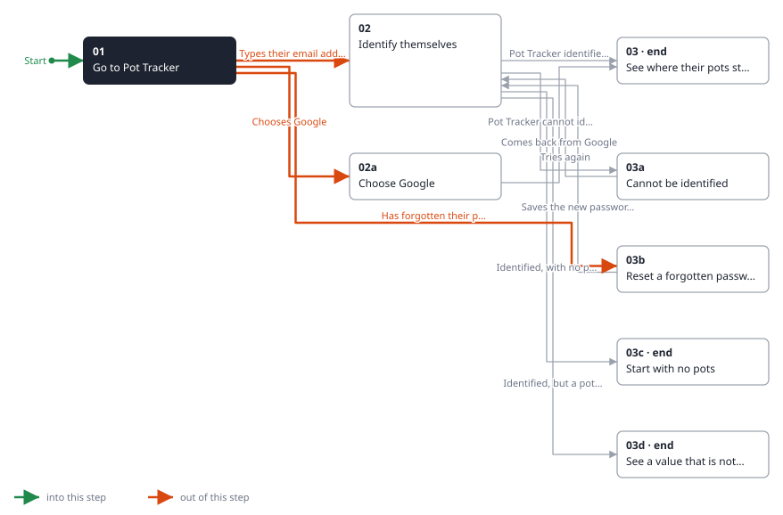
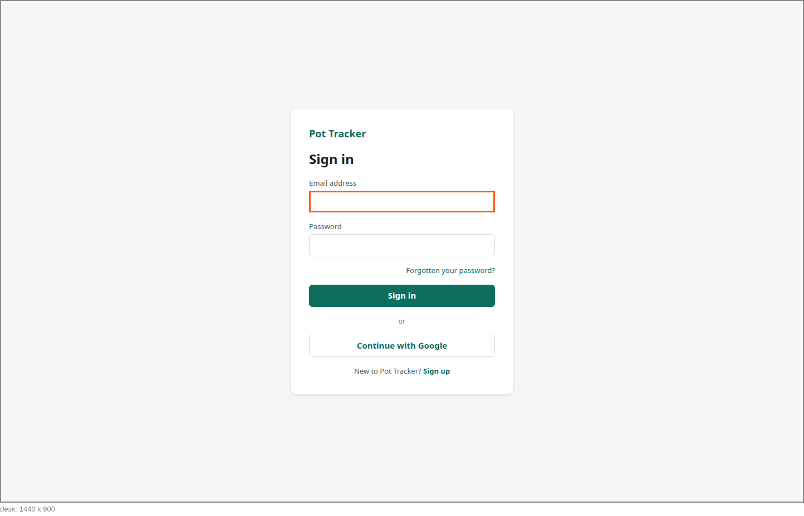

<!-- Generated by ui-walkthrough from WALKTHROUGH.yaml and STEP.yaml. Do not edit. -->
# Sign in

↑ [The whole walkthrough](../WALKTHROUGH.desk.md)

**desk** · [phone](STEP.phone.md)

## 01 Go to Pot Tracker

| Previous | Next |
|:---|---:|
| *Start* | *Types their email address* (types in `SIGN-IN.EMAIL`): [02 Identify themselves](../02-identify/STEP.desk.md) → |
|  | *Chooses Google* (clicks `SIGN-IN.GOOGLE`): [02a Choose Google](../02a-google/STEP.desk.md) → |
|  | *Has forgotten their password* (clicks `SIGN-IN.FORGOTTEN`): [03b Reset a forgotten password](../03b-forgotten-password/STEP.desk.md) → |

The saver goes to Pot Tracker. They are not signed in, so it shows only the sign-in: nothing of anyone's pots is on
the screen until they have identified themselves.

**Views**

* [APP](../../../views/APP/VIEW.md)
  * *shows*: [SIGN-IN](../../../views/SIGN-IN/VIEW.md)

## In this step

* **SIGN-IN.EMAIL** (highlighted): The email address the saver types.
* **SIGN-IN.GOOGLE**: Identifies the saver with their Google account instead.
* **SIGN-IN.FORGOTTEN**: Starts resetting the password, for a saver who has forgotten it.
