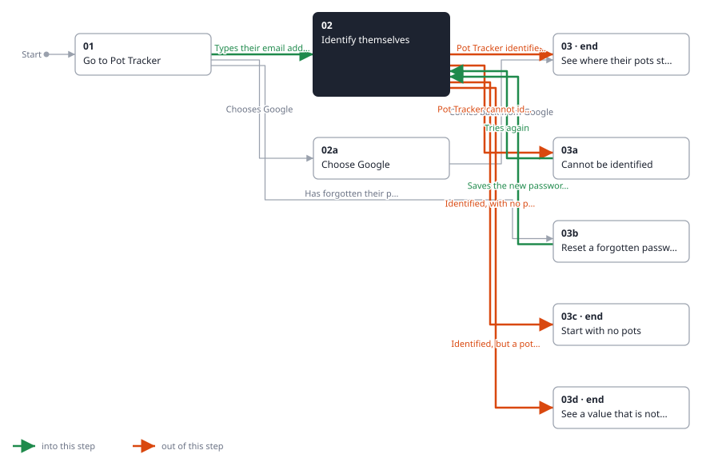
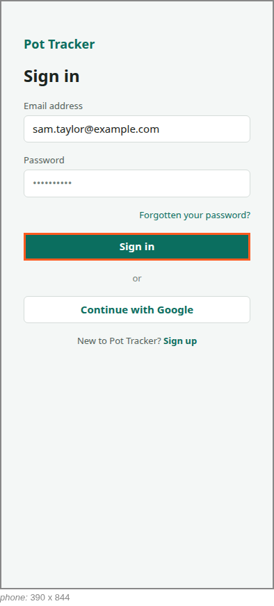

<!-- Generated by ui-walkthrough from WALKTHROUGH.yaml and STEP.yaml. Do not edit. -->
# Sign in

↑ [The whole walkthrough](../WALKTHROUGH.phone.md)

[desk](STEP.desk.md) · **phone**

## 02 Identify themselves

| Previous | Next |
|:---|---:|
| ← *Types their email address* (types in `SIGN-IN.EMAIL`) from [01 Go to Pot Tracker](../01-go-to-pot-tracker/STEP.phone.md) | *Pot Tracker identifies them* (when `saver-identified` happens): [03 See where their pots stand](../03-overview/STEP.phone.md) → |
| ← *Tries again* (types in `SIGN-IN.PASSWORD`) from [02b Cannot be identified](../02b-not-identified/STEP.phone.md) | *Pot Tracker cannot identify them* (when `saver-not-identified` happens): [02b Cannot be identified](../02b-not-identified/STEP.phone.md) → |
| ← *Saves the new password and signs in* (clicks `RESET-PASSWORD.SAVE`) from [02c Reset a forgotten password](../02c-forgotten-password/STEP.phone.md) | *Identified, with no pots yet* (when `saver-identified-with-no-pots` happens): [03a Start with no pots](../03a-no-pots/STEP.phone.md) → |
|  | *Identified, but a pot could not be brought up to date* (when `pot-not-brought-up-to-date` happens): [03b See a value that is not up to date](../03b-not-up-to-date/STEP.phone.md) → |

The saver gives their email address and password, and signs in. The password is typed and sent, never held by the
UI.

**Views**

* [APP](../../../views/APP/VIEW.md)
  * *shows*: [SIGN-IN](../../../views/SIGN-IN/VIEW.md)

## In this step

* **SIGN-IN.SUBMIT** (highlighted): Identifies the saver with the email address and password.
* **SIGN-IN.EMAIL**: The email address the saver types.
* **SIGN-IN.PASSWORD**: The password the saver types. Never held as state, so a step shows it as dots.
