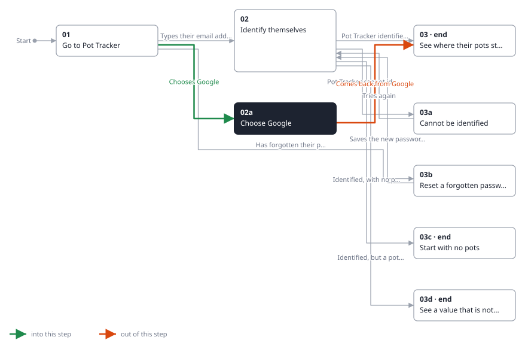
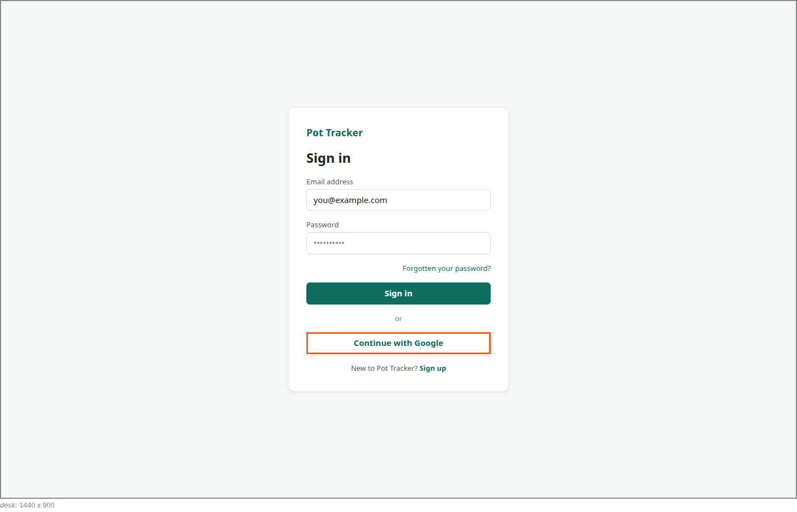

<!-- Generated by ui-walkthrough from WALKTHROUGH.yaml and STEP.yaml. Do not edit. -->
# Sign in

↑ [The whole walkthrough](../WALKTHROUGH.desk.md)

**desk** · [phone](STEP.phone.md)

## 02a Choose Google

| Previous | Next |
|:---|---:|
| ← *Chooses Google* (clicks `SIGN-IN.GOOGLE`) from [01 Go to Pot Tracker](../01-go-to-pot-tracker/STEP.desk.md) | *Comes back from Google, identified* (when `saver-identified` happens): [03 See where their pots stand](../03-overview/STEP.desk.md) → |
| ← *Tries Google* (clicks `SIGN-IN.GOOGLE`) from [02b Cannot be identified](../02b-not-identified/STEP.desk.md) | *Comes back from Google, not identified* (when `saver-not-identified` happens): [02b Cannot be identified](../02b-not-identified/STEP.desk.md) → |
|  | *Comes back identified, with no pots yet* (when `saver-identified-with-no-pots` happens): [03a Start with no pots](../03a-no-pots/STEP.desk.md) → |
|  | *Comes back identified, but a pot could not be brought up to date* (when `pot-not-brought-up-to-date` happens): [03b See a value that is not up to date](../03b-not-up-to-date/STEP.desk.md) → |

The saver chooses to identify themselves with their Google account. Google's own page is not this UI's, so the step
shows where the saver leaves from; they come back signed in.

**Views**

* [APP](../../../views/APP/VIEW.md)
  * *shows*: [SIGN-IN](../../../views/SIGN-IN/VIEW.md)

## In this step

* **SIGN-IN.GOOGLE** (highlighted): Identifies the saver with their Google account instead.
