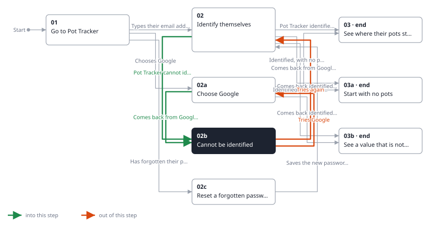
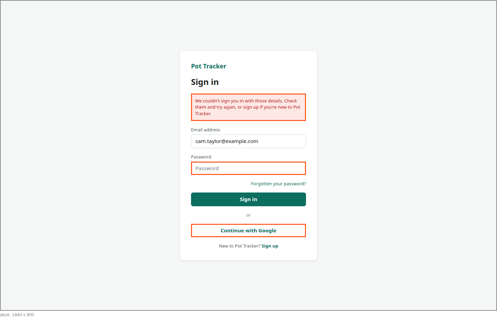

<!-- Generated by ui-walkthrough from WALKTHROUGH.yaml and STEP.yaml. Do not edit. -->
# Sign in

↑ [The whole walkthrough](../WALKTHROUGH.desk.md)

**desk** · [phone](STEP.phone.md)

## 02b Cannot be identified

| Previous | Next |
|:---|---:|
| ← *Pot Tracker cannot identify them* (when `saver-not-identified` happens) from [02 Identify themselves](../02-identify/STEP.desk.md) | *Tries again* (types in `SIGN-IN.PASSWORD`): [02 Identify themselves](../02-identify/STEP.desk.md) → |
| ← *Comes back from Google, not identified* (when `saver-not-identified` happens) from [02a Choose Google](../02a-google/STEP.desk.md) | *Tries Google* (clicks `SIGN-IN.GOOGLE`): [02a Choose Google](../02a-google/STEP.desk.md) → |

Pot Tracker cannot identify the saver from what they gave: the password is wrong, or the address, or the Google
account they came back with, is not one of its users. They are told so without being told which, and offered
signing up. An address they typed is kept; the password is not.

**Views**

* [APP](../../../views/APP/VIEW.md)
  * *shows*: [SIGN-IN](../../../views/SIGN-IN/VIEW.md)

## In this step

* **SIGN-IN.NOT-IDENTIFIED** (highlighted): Tells the saver they could not be identified, without saying whether the email address or the password was wrong, and offers signing up.
* **SIGN-IN.PASSWORD** (highlighted): The password the saver types. Never held as state, so a step shows it as dots.
* **SIGN-IN.GOOGLE** (highlighted): Identifies the saver with their Google account instead.
* **SIGN-IN.SIGN-UP**: Opens signing up, for a saver who is not yet one of Pot Tracker's users.
