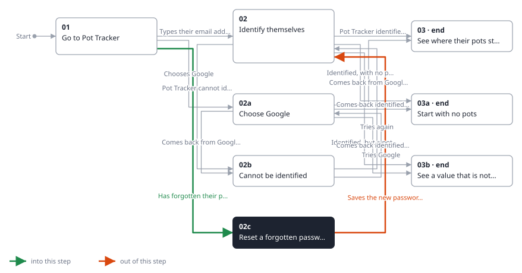
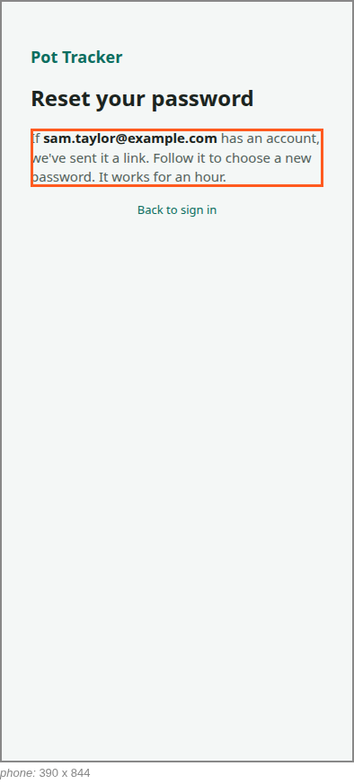
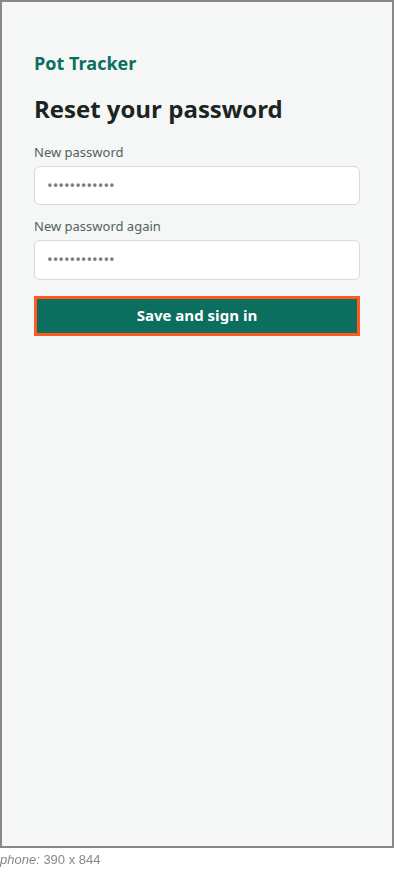

<!-- Generated by ui-walkthrough from WALKTHROUGH.yaml and STEP.yaml. Do not edit. -->
# Sign in

↑ [The whole walkthrough](../WALKTHROUGH.phone.md)

[desk](STEP.desk.md) · **phone**

## 02c Reset a forgotten password

| Previous | Next |
|:---|---:|
| ← *Has forgotten their password* (clicks `SIGN-IN.FORGOTTEN`) from [01 Go to Pot Tracker](../01-go-to-pot-tracker/STEP.phone.md) | *Saves the new password and signs in* (clicks `RESET-PASSWORD.SAVE`): [02 Identify themselves](../02-identify/STEP.phone.md) → |

The saver has forgotten their password. They give their email address and are sent a link, told only that one has
been sent if the address has an account. Following the link from their email, they choose a new password, and are
back at signing in.

### 1. The saver asks for a link

**Views**

* [APP](../../../views/APP/VIEW.md)
  * *shows*: [RESET-PASSWORD](../../../views/RESET-PASSWORD/VIEW.md)

* **RESET-PASSWORD.SEND** (highlighted): Sends the link.

### 2. The link is sent, if the address has an account

**Views**

* [APP](../../../views/APP/VIEW.md)
  * *shows*: [RESET-PASSWORD](../../../views/RESET-PASSWORD/VIEW.md)

* **RESET-PASSWORD.SENT** (highlighted): Says the link has been sent, if the address is a user's, and to follow it from their email.

### 3. Having followed the link, the saver chooses a new password

**Views**

* [APP](../../../views/APP/VIEW.md)
  * *shows*: [RESET-PASSWORD](../../../views/RESET-PASSWORD/VIEW.md)

* **RESET-PASSWORD.SAVE** (highlighted): Saves the new password, and goes back to signing in.
* **RESET-PASSWORD.CHOOSE**: Asks for the new password, twice.
