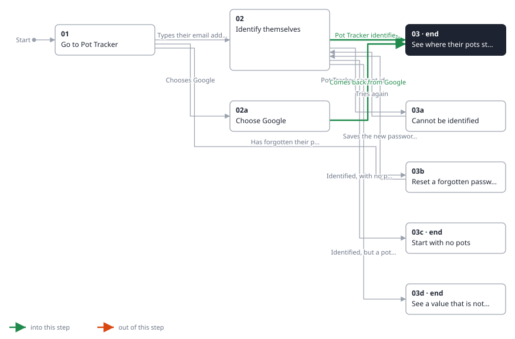
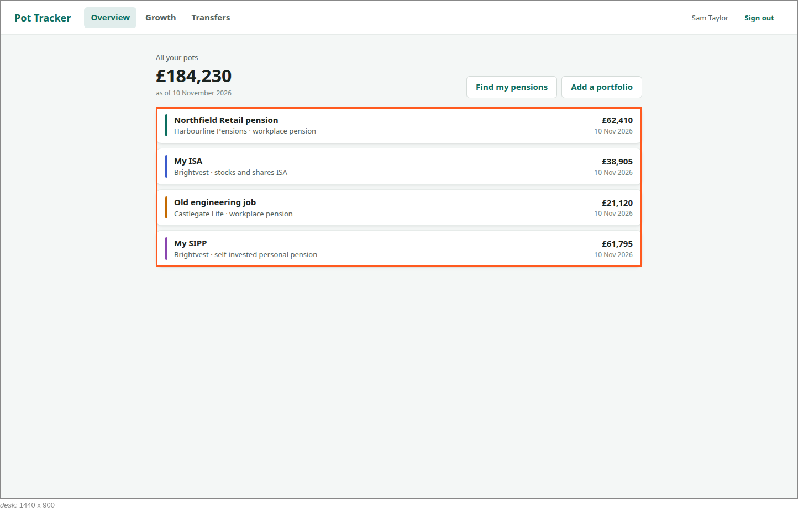

<!-- Generated by ui-walkthrough from WALKTHROUGH.yaml and STEP.yaml. Do not edit. -->
# Sign in

↑ [The whole walkthrough](../WALKTHROUGH.desk.md)

**desk** · [phone](STEP.phone.md)

## 03 See where their pots stand

| Previous | Next |
|:---|---:|
| ← *Pot Tracker identifies them* (when `saver-identified` happens) from [02 Identify themselves](../02-identify/STEP.desk.md) | **End:** the saver is signed in, and sees where their pots stand. |
| ← *Comes back from Google, identified* (when `saver-identified` happens) from [02a Choose Google](../02a-google/STEP.desk.md) |  |

The saver is signed in, and sees an overview of their pots: each one's value and when that was, and what they add up
to. Each pot carries its own colour, which it keeps wherever it is shown.

**Views**

* [APP](../../../views/APP/VIEW.md)
  * *shows*: [SHELL](../../../views/SHELL/VIEW.md)
    * *main*: [OVERVIEW](../../../views/OVERVIEW/VIEW.md)
      * *pots*: [POT-ROW](../../../views/POT-ROW/VIEW.md) × 4

## In this step

* **OVERVIEW.POTS** (highlighted): A row for each pot.
* **SHELL**: The frame around everything a signed-in saver does: Pot Tracker's name, where they can go, who they are and signing out, and what they are doing in the middle. On a phone, where they can go moves to a bar at the bottom.
* **OVERVIEW.TOTAL**: What every pot adds up to.
