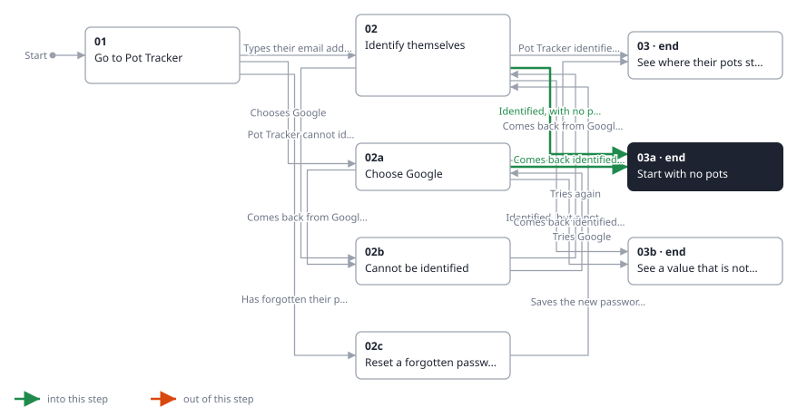
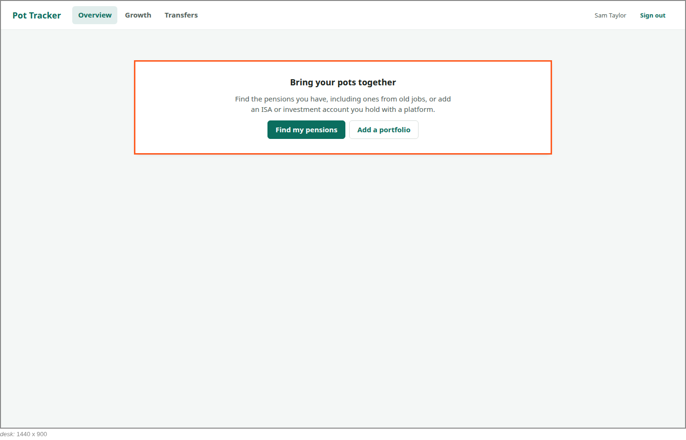

<!-- Generated by ui-walkthrough from WALKTHROUGH.yaml and STEP.yaml. Do not edit. -->
# Sign in

↑ [The whole walkthrough](../WALKTHROUGH.desk.md)

**desk** · [phone](STEP.phone.md)

## 03a Start with no pots

| Previous | Next |
|:---|---:|
| ← *Identified, with no pots yet* (when `saver-identified-with-no-pots` happens) from [02 Identify themselves](../02-identify/STEP.desk.md) | **End:** the saver is signed in, and offered the two ways to start. |
| ← *Comes back identified, with no pots yet* (when `saver-identified-with-no-pots` happens) from [02a Choose Google](../02a-google/STEP.desk.md) |  |

The saver has no pots yet, so there is nothing to add up. They are offered the two ways to start, as on signing up:
finding their pensions, and adding an investment portfolio.

**Views**

* [APP](../../../views/APP/VIEW.md)
  * *shows*: [SHELL](../../../views/SHELL/VIEW.md)
    * *main*: [OVERVIEW](../../../views/OVERVIEW/VIEW.md)

## In this step

* **OVERVIEW.START** (highlighted): With no pots yet, explains the two ways to start: finding pensions and adding a portfolio.
* **OVERVIEW.START-FIND**: Starts finding the saver's pensions, from the explanation shown with no pots.
* **OVERVIEW.START-ADD**: Starts adding an investment portfolio, from the explanation shown with no pots.
