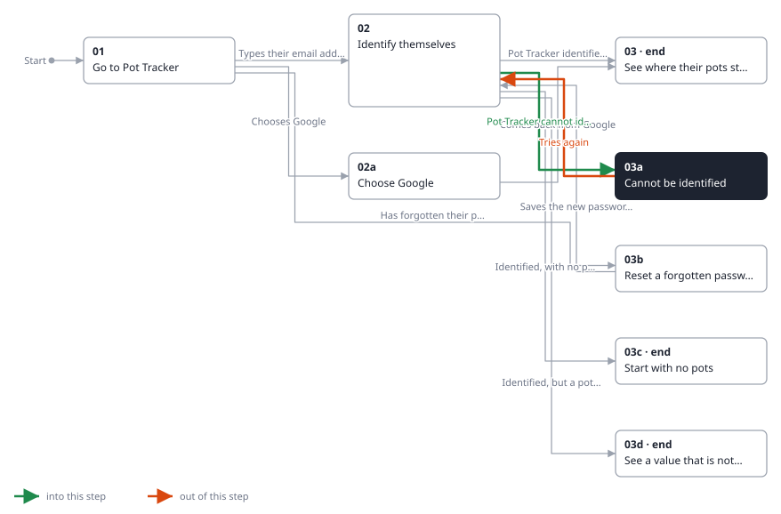
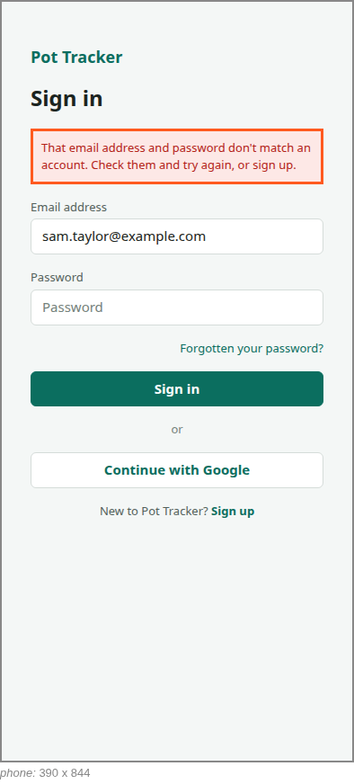

<!-- Generated by ui-walkthrough from WALKTHROUGH.yaml and STEP.yaml. Do not edit. -->
# Sign in

↑ [The whole walkthrough](../WALKTHROUGH.phone.md)

[desk](STEP.desk.md) · **phone**

## 03a Cannot be identified

| Previous | Next |
|:---|---:|
| ← *Pot Tracker cannot identify them* (when `saver-not-identified` happens) from [02 Identify themselves](../02-identify/STEP.phone.md) | *Tries again* (types in `SIGN-IN.PASSWORD`): [02 Identify themselves](../02-identify/STEP.phone.md) → |

Pot Tracker cannot identify the saver from what they gave: the password is wrong, or the address is not one of its
users. They are told so without being told which, and offered signing up. The address they typed is kept; the
password is not.

**Views**

* [APP](../../../views/APP/VIEW.md)
  * *shows*: [SIGN-IN](../../../views/SIGN-IN/VIEW.md)

## In this step

* **SIGN-IN.NOT-IDENTIFIED** (highlighted): Tells the saver they could not be identified, without saying whether the email address or the password was wrong, and offers signing up.
* **SIGN-IN.SIGN-UP**: Opens signing up, for a saver who is not yet one of Pot Tracker's users.
