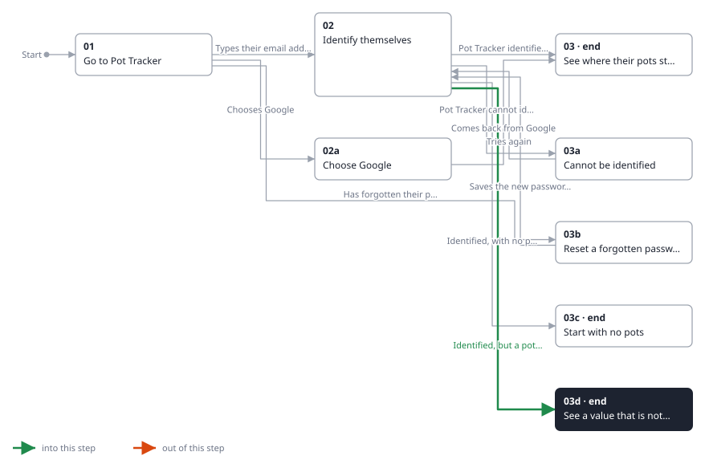
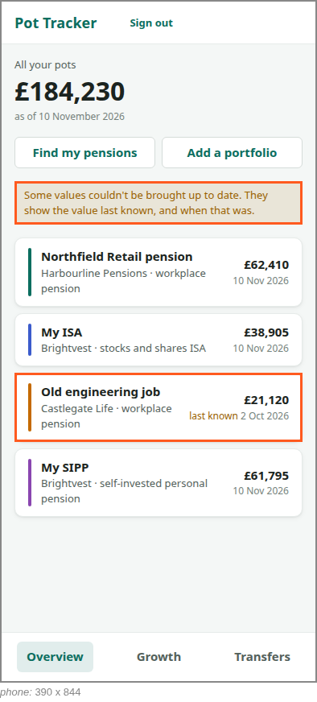

<!-- Generated by ui-walkthrough from WALKTHROUGH.yaml and STEP.yaml. Do not edit. -->
# Sign in

↑ [The whole walkthrough](../WALKTHROUGH.phone.md)

[desk](STEP.desk.md) · **phone**

## 03d See a value that is not up to date

| Previous | Next |
|:---|---:|
| ← *Identified, but a pot could not be brought up to date* (when `pot-not-brought-up-to-date` happens) from [02 Identify themselves](../02-identify/STEP.phone.md) | **End:** the saver is signed in, and knows which value is not up to date. |

One provider could not be reached, so one pot's value could not be brought up to date. It is shown as the value last
known, and when that was, and the overview says so. The total includes it as last known.

**Views**

* [APP](../../../views/APP/VIEW.md)
  * *shows*: [SHELL](../../../views/SHELL/VIEW.md)
    * *main*: [OVERVIEW](../../../views/OVERVIEW/VIEW.md)
      * *pots*: [POT-ROW](../../../views/POT-ROW/VIEW.md) × 4

## In this step

* **OVERVIEW.STALE** (highlighted): Says some pots' values could not be brought up to date, and are shown as last known.
* **POT-ROW#3** (highlighted): One pot in a list: its colour, its name, its provider and kind, and its value with when that was.
