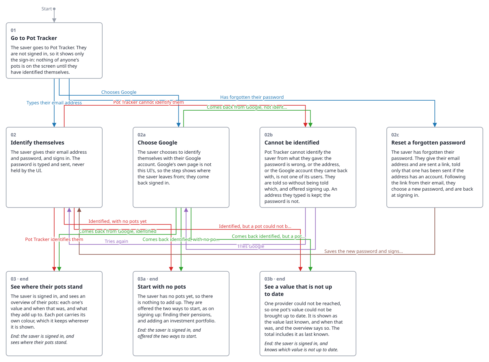

<!-- Generated by ui-walkthrough from WALKTHROUGH.yaml. Do not edit. -->
# Sign in

Describes [Sign In](../../../use-cases/sign-in/USE-CASE.md).

**desk** · [phone](WALKTHROUGH.phone.md)

## Steps

* [01 Go to Pot Tracker](01-go-to-pot-tracker/STEP.desk.md): a way in, *Start*
* [02 Identify themselves](02-identify/STEP.desk.md)
* [02a Choose Google](02a-google/STEP.desk.md)
* [03 See where their pots stand](03-overview/STEP.desk.md): ends the walkthrough
* [03a Cannot be identified](03a-not-identified/STEP.desk.md)
* [03b Reset a forgotten password](03b-forgotten-password/STEP.desk.md)
* [03c Start with no pots](03c-no-pots/STEP.desk.md): ends the walkthrough
* [03d See a value that is not up to date](03d-not-up-to-date/STEP.desk.md): ends the walkthrough
